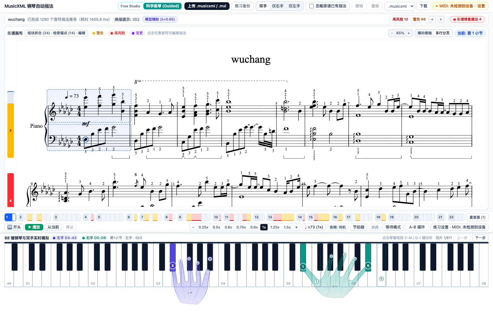
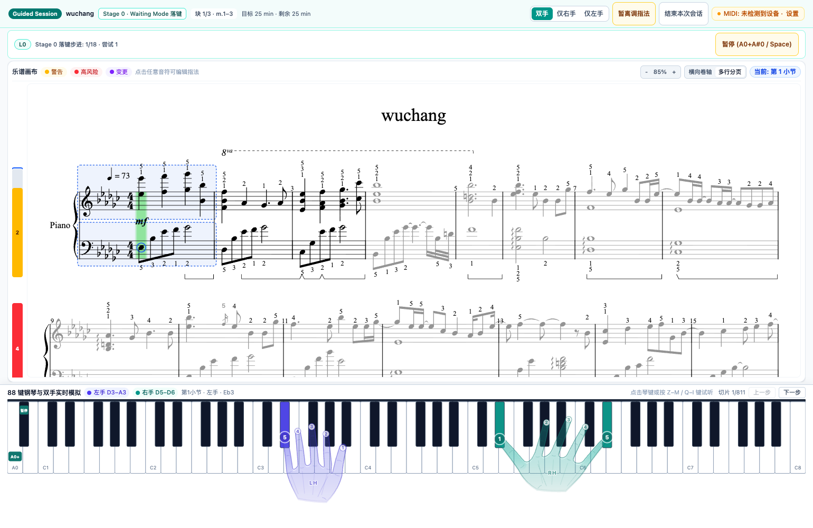
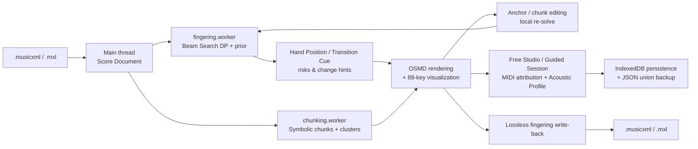

# MusicXML Piano Auto-Fingering

> A 100% browser-local studio for MusicXML piano fingering: upload a score, deduce `1–5` fingerings, tweak anchors note by note, practice measure by measure with a digital piano, and export the score losslessly with standard `<fingering>` annotations. No backend — your score never leaves the browser.

[中文](README.md) · **English**

[](https://www.typescriptlang.org/)
[](https://react.dev/)
[](https://vite.dev/)
[](https://vitest.dev/)
[](https://github.com/sunstrikes/auto-fingering/actions/workflows/ci.yml)
[](LICENSE)



*Real-world sample “Wuchang” (73 measures, 1,290 onset notes): solved in **1405.9 ms** inside a Web Worker with Model Assist (`λ=0.85`) enabled (352 transition cues). Left: per-measure risk gutter. Bottom: motor-chunk strip, practice transport bar, and shared 88-key keyboard with real-time two-hand posture.*

## Features

- **Automatic fingering & score repair** — beam-search dynamic programming over `Onset Slice`s (all newly struck notes of one hand at the same onset), covering both hands, cross-staff voices, chords, `Tie Continuation`s, `Grace Note`s and existing finger anchors. Configure `S` / `M` / `L` `Hand Span Profile`, “avoid thumb on black keys” and “prefer stable hand positions” in Settings, alongside the default-on **Model Assist (Beta) pretrained Transformer soft prior** (pure-TS CPU forward pass, lazy-loaded ~0.8 MB weights, tunable `λ` or switchable back to classic DP while P0 span and anchor constraints hold absolute veto power). Includes **Score Repair** suggestions to locate and patch high-risk stretches or fingering anomalies.
- **Dual-hand 88-key & risk visualization** — inline fingering bubbles on the score, `Hand Position` bands, `Transition Cue`s (thumb-under, cross-over, position shift, wide stretch), a per-measure risk gutter on the left margin, horizontal-scroll / paginated layouts, zoom and `<` `>` warning navigation. A shared 88-key keyboard distinguishes the hands by colour and renders continuous SVG `Hand Posture` skeletons.
- **Symbolic chunking & retrieval cues** — a dedicated `chunking.worker` runs symbolic phrase chunking, `Passage Cluster` repetition detection and motor-overlay analysis; supports manual barline Split/Merge overrides and `Performance Cue` editing.
- **Interactive overrides** — while stopped, click any note to pin an anchor and locally re-solve only the affected phrase in the worker. Supports `phrase` / `pinOnly` anchor semantics, undo/redo and a `Before → After` diff.
- **Free Studio practice**:
  - continuous `0.25x–1.5x` speed scaling with proportional BPM remapping, an independent metronome and a one-measure `Count-In`;
  - Web MIDI digital-piano input with hot-plug, port selection, selectable piano timbres and local-sound toggle, plus virtual 88-key / QWERTY input when no piano is connected;
  - `Waiting Mode` advances one practice step at a time and accepts rolled chords (accumulated `NoteOn` hits), guards against repeated same-pitch notes, flags wrong notes in red, can skip grace notes, and supports strictness toggles;
  - `Practice Mode`: both hands / right hand only (left-hand accompaniment) / left hand only (right-hand accompaniment);
  - whole-measure `A-B Loop`, optionally with a one-measure gap between repetitions.
- **Guided Session (science-based practice)**:
  - single-piece time-boxed scheduling (`15 / 25 / 40 min`), `MacroSection` filtering, blind probe, cold-start drill and full-piece quick triage;
  - interleaved `Motor-FSRS` & `MotorScheduler` queueing, Stage 0 step-by-step waiting (graduates after 1 pass at ≥90% or a 2-minute cap), speed ladders and `Bridge Window` transitions;
  - zero-reflow OSMD SVG Fading Scaffolding (`L0–L3`, L3 silent beat and `B0` 1.5s fingering peek), configurable Eye-Hand Span (`EHS`) overlay, `Micro-Rest` / `Early Macro-Rest` veils and `Audiation Priming`;
  - hands-on-keys command routing via `A0` / `A0+A#0` / `B0` / `C8` (plus optional `CC64` sustain pedal).
- **5-dimension Acoustic Profile & External-Focus Coach** — `Bounded Window Attribution` computes 5 hardware-invariant acoustic capsules (timing evenness, voicing, articulation, pedal clarity, hand sync) and trouble-measure hotspots after continuous bouts; `External-Focus Coach` provides offline templates plus optional BYOK / PKCE LLM coaching (sending structured summaries only, never raw MIDI timestamps).
- **Lossless import/export & local persistence** — `.musicxml`, `.xml` and `.mxl` export preserving original layout, `<direction>`, `<lyric>` and existing `<fingering>` tags; IndexedDB caching for scores, anchor drafts and practice events with cross-device JSON union backup/merge.
- **MuseScore import CLI** — `npm run musescore:import` (`bin/musescore-import.mjs`) converts MuseScore 4 SVG pages + MIDI into `.musicxml` / `.mxl`.
- **Private by design** — parsing, solving, chunking, acoustic profiling, audio synthesis and export all run in the browser. Both the DP solver and symbolic chunker run inside Web Workers so the UI stays responsive.



*Guided Session Stage 0 view: active chunk focus framing, dimmed non-active measures, `A0+` command-key badge, and 88-key hand posture guidance.*

## Quick start

Requirements: **Node.js `>=22.12.0`** (required by Vite 8 and Vitest 5) and npm.

```bash
git clone git@github.com:sunstrikes/auto-fingering.git
cd auto-fingering
npm install
npm run dev
```

Open <https://localhost:5173> (local self-signed HTTPS is enabled for Web MIDI) and upload any sample from [`test-corpus/`](test-corpus/) (`01`–`05`).

Production build and preview:

```bash
npm run build
npm run preview
```

## Workflow

1. **Import** a `.musicxml` / `.xml` / `.mxl` score. Parsing runs on the main thread, followed automatically by worker fingering solve and symbolic chunking.
2. **Configure hand profile & preferences** in top-right **Settings** — `S` / `M` / `L`, “avoid thumb on black keys”, “prefer stable positions”, and **Model Assist (Beta)** mode/`λ` — or check “ignore existing fingerings” in the header; open **Score Repair** if high-risk stretches are flagged.
3. **Inspect, chunk & refine** in paginated or horizontal-scroll layout; jump between warnings with `<` `>`; open the Chunk/Cue editor to adjust barline splits or performance cues; click a note while stopped to pin a finger and re-solve locally.
4. **Practice** in **Free Studio** using the transport bar (speed, metronome, waiting mode, A-B loop), or switch to **Guided Session** in the header for time-boxed scheduling, Stage 0 waiting, fading scaffolding, EHS, and 5-dimension acoustic feedback.
5. **Back up & export** via **Practice Backup** (JSON export/merge) or download as `.musicxml` / `.mxl` with standard `<fingering>` tags written back losslessly.

## Architecture



| Layer | Choice |
| --- | --- |
| UI | React 19 + TypeScript (strict) + Tailwind CSS 4 |
| Build | Vite 8 (Rolldown) + Web Workers (`fingering.worker` / `chunking.worker`) |
| Score rendering | [OpenSheetMusicDisplay](https://opensheetmusicdisplay.org/) + zero-reflow SVG scaffolding / EHS overlays |
| State & history | Zustand (`useStudioStore` / `useGuidedSessionStore`, undo/redo) |
| Persistence | IndexedDB (`indexedDbStorage`) + cross-device JSON union replay merge (`backupMerge`) |
| Container I/O | JSZip (with the `STORE` mimetype rule for `.mxl`) |
| Audio | Web Audio API + [smplr](https://github.com/danigb/smplr) samples, with a built-in harmonic synth fallback |
| Input | Web MIDI API (hot-plug, port selection) + virtual 88-key / QWERTY fallback + piano command-key router |
| Tests | Vitest + jsdom + Chrome Playwright browser checks |

## Project structure

```text
bin/
└── musescore-import.mjs # MuseScore 4 import CLI entrypoint
src/
├── domain/              # Domain model and pure data contracts (NoteEvent / OnsetSlice / PracticeStep ...)
├── musicxml/            # Parsing, lossless write-back, repair write-back, .mxl container I/O
├── solver/              # Beam-search DP, cost model, hand positions & cues, local anchor re-solve, score repair
├── prior/               # Pretrained Transformer soft prior (26×5 token adapter, pure-TS forward pass & lazy loader)
├── chunking/            # Symbolic chunk static analyzer, motor overlay, manual split/merge overrides
├── guided/              # Guided Session engine (Motor-FSRS, scheduler, acoustic profile, EHS, fading scaffolding, command keys)
├── coach/               # Closed-world External-Focus Coach (local templates, structured payload, verifier & BYOK adapters)
├── workers/             # fingering.worker & chunking.worker entrypoints and typed RPC
├── audio/               # Piano engine, metronome, playback / clock-anchor / waiting / A-B loop scheduler
├── midi/                # Web MIDI hot-plug, port selection, virtual input, ring buffer & session capture
├── persistence/         # IndexedDB storage, draft remapping, multi-device JSON union backup merge
├── store/               # Zustand stores (Studio / Guided Session), undo/redo, diffing
├── hooks/               # Persistence, score lifecycle, chunking, Guided Session & coach hooks
├── components/          # ScoreViewer / UnifiedPiano88 / GuidedSessionLaunchCard / PracticeSettingsModal ...
├── practice/            # Waiting-mode state machine, practice-step projection and analytics
└── musescore/           # MuseScore 4 SVG/MIDI parsing, alignment and MusicXML 4.0 builder
scripts/                 # Chrome Playwright E2E acceptance and multi-viewport layout regression scripts
tests/                   # Vitest suites and test-corpus regression gates
docs/                    # ADRs, design plans, screenshots and deployment notes
test-corpus/             # Regression samples 01–05 (including “Wuchang”) and ms4-fixtures
```

## Scripts

| Command | Description |
| --- | --- |
| `npm run dev` | Start the Vite dev server (default <https://localhost:5173>) |
| `npm run build` | Production build into `dist/` |
| `npm run preview` | Preview the production build (default <https://localhost:4173>) |
| `npm run typecheck` | `tsc --noEmit` type check |
| `npm test` | Run all Vitest suites |
| `npm run musescore:import` | Run the MuseScore 4 to MusicXML CLI (`bin/musescore-import.mjs`) |
| `npx vitest run --coverage` | Generate the coverage report (`coverage/`) |

## Tests and regression gates

The regression corpus lives in [`test-corpus/`](test-corpus/) and enforces the acceptance rules from [SPEC.md](SPEC.md) §7:

- hard constraints: existing anchors honored (when physically possible), no fingering on tie continuations, no illegal same-hand duplicate fingers;
- performance budget: the real-world “Wuchang” score (73 measures, 1,290 onset notes) solves in ≤ 200 ms with classic DP, a local anchor re-solve in ≤ 20 ms;
- export compatibility: written-back `.musicxml` / `.mxl` files load in OSMD and piano.cishoon.top, preserving `<lyric>`, `<direction>`, `<slur>` and original fingering nodes;
- practice & guided behavior: metronome/count-in, proportional tempo scaling, Web MIDI parsing, waiting-mode state machine, A-B looping, symbolic chunking, Motor-FSRS, acoustic profiling, EHS overlay and fading scaffolding all have dedicated suites.
- performance budgets keep the SPEC values locally; on shared CI runners they are scaled by `PERF_BUDGET_SCALE` (default `3`) to absorb hardware jitter. Override the variable locally to reproduce the strict gate.

Browser E2E checks (requires local Chrome; set `CHROME_PATH` to override the executable and `STUDIO_URL` to override the target URL):

- **M1 check** (against `npm run dev`, default `https://localhost:5173/`): `node scripts/check-m1-browser.mjs` — verifies Waiting Mode with simulated MIDI, cached `.mxl` reload, repair undo/redo, and both backup modes.
- **M2–M5 Guided Session check** (recommended against `npm run build && npm run preview`, default `https://localhost:4173/`): `node scripts/check-m2-m5-browser.mjs` — verifies symbolic chunking, split/merge persistence, launch card, `A0+A#0` pause/resume, L2/L3 zero-reflow scaffolding, `B0` peek, Micro-Rest, 5-dim Acoustic Profile, BYOK Coach (zero secret/timestamp leak) and EHS overlay.
- **Multi-viewport layout check** (against `npm run dev`, default `https://localhost:5173/`): `node scripts/check-score-layout-browser.mjs` — verifies horizontal-scroll and paginated layouts, chunk editor modal and non-overlap invariants across desktop (`2560×1320`, `1920×950`, `1440×900`) and iPad viewports.

## Deployment

This is a purely static SPA: run `npm run build` and serve `dist/` from any static host. There is no server-side code and no SPA route fallback needed (the app only uses the root path).

- `ci.yml` runs typecheck, tests and the production build on Node 22/24.
- `deploy-edgeone.yml` publishes `dist/` to EdgeOne Pages on tags or manual dispatch; configure the `EDGEONE_PAGES_API_TOKEN` secret and, optionally, the `EDGEONE_PROJECT_NAME` repository variable.
- Step-by-step EdgeOne Pages instructions, anonymous previews and project claiming are in [docs/deployment-edgeone.md](docs/deployment-edgeone.md).

## Documentation

| Document | Content |
| --- | --- |
| [SPEC.md](SPEC.md) | Product scope, data contracts, algorithms and acceptance gates |
| [GLOSSARY.md](GLOSSARY.md) | Domain glossary (Chinese/English) |
| [ADR-0001](docs/adr/0001-dual-hand-88key-timeline-studio.md) | Dual-hand 88-key timeline studio |
| [ADR-0002](docs/adr/0002-interactive-practice-midi-waiting-loop.md) | Interactive practice (metronome / MIDI / waiting mode / A-B loop) |
| [docs/chord-and-scale-fingering-plan.md](docs/chord-and-scale-fingering-plan.md) | Chord and scale fingering plan |
| [docs/octave-span-and-score-repair-plan.md](docs/octave-span-and-score-repair-plan.md) | Octave span and score repair plan |
| [docs/musescore-import-phase0.md](docs/musescore-import-phase0.md) | MuseScore 4 import notes |
| [test-corpus/README.md](test-corpus/README.md) | Regression samples and expected results |

## Browser support and limitations

- **Web MIDI** is currently Chromium-only and requires HTTPS or `localhost`; Safari/Firefox fall back to the on-screen 88-key keyboard or QWERTY input.
- Targets two-hand piano scores over A0–C8 (88 keys). Three-or-more-staff scores, four-hand piano and non-piano instruments are out of scope.
- Piano samples are lazily loaded on first playback; if the network is unavailable the engine falls back to Web Audio synthesis. Fingering is unaffected.
- Fingering suggestions come from a cost model and are meant as practice references; use `S`/`M`/`L` in Settings and note anchors to match your own hands.

## License and Third-Party Notices

Licensed under the [Apache License 2.0](LICENSE). Copyright 2026 sunstrikes — see [NOTICE](NOTICE).

The **Model Assist (Beta)** mode uses the 26-token feature encoding and pretrained Transformer encoder weights from [`@lumikey/piano-fingering-model`](https://github.com/lumikey/piano-fingering-model) (MIT declared in npm `package.json`). Upstream training datasets include preprocessed data from the PIG dataset (Eita Nakamura, Yasuyuki Saito, and Kazuyoshi Yoshii, *"Statistical Learning and Estimation of Piano Fingering"*, Information Sciences, Vol. 517, pp. 68–85, 2020; restricted to nonprofit/academic use — no PIG dataset files are bundled or redistributed in this repository). See [NOTICE](NOTICE) for provenance details and the `VITE_BUNDLE_PRIOR=0` unbundling switch.
