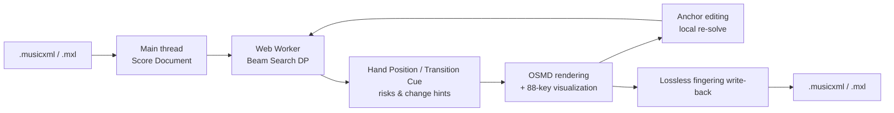

# MusicXML Piano Auto-Fingering

> A 100% browser-local studio for MusicXML piano fingering: upload a score, deduce `1–5` fingerings, tweak anchors note by note, practice measure by measure with a digital piano, and export the score losslessly with standard `<fingering>` annotations. No backend — your score never leaves the browser.

[中文](README.md) · **English**

[](https://www.typescriptlang.org/)
[](https://react.dev/)
[](https://vite.dev/)
[](https://vitest.dev/)
[](https://github.com/sunstrikes/auto-fingering/actions/workflows/ci.yml)
[](LICENSE)


*Real-world sample “Wuchang” (73 measures, 1,290 onset notes): the whole score is solved in **15.6 ms** inside a Web Worker. Right: per-measure risk gutter. Bottom: shared 88-key keyboard with two-hand posture and transition cues.*

## Features

- **Automatic fingering** — beam-search dynamic programming over `Onset Slice`s (all newly struck notes of one hand at the same onset), covering both hands, cross-staff voices, chords, `Tie Continuation`s, `Grace Note`s and existing finger anchors. Choose an `S` / `M` / `L` `Hand Span Profile`, plus “avoid thumb on black keys” and “prefer stable hand positions” switches, with an opt-in **Model Assist (Beta) pretrained Transformer soft prior** (pure-TS CPU forward pass, lazy-loaded ~0.8 MB weights, reordering only among physically feasible candidates while P0 span and anchor constraints hold absolute veto power).
- **Dual-hand 88-key visualization** — inline fingering bubbles on the score, `Hand Position` bands, `Transition Cue`s (thumb-under, cross-over, position shift, wide stretch) and a per-measure risk gutter. A shared 88-key keyboard distinguishes the hands by colour and renders continuous SVG `Hand Posture` skeletons.
- **Interactive overrides** — while stopped, click any note to pin an anchor and locally re-solve only the affected phrase in the worker. Supports `phrase` / `pinOnly` anchor semantics, undo/redo and a `Before → After` diff.
- **Practice tools**:
  - continuous `0.25x–1.5x` speed scaling with proportional BPM remapping, an independent metronome and a one-measure `Count-In`;
  - Web MIDI digital-piano input with hot-plug, port selection and an optional local-sound toggle, plus virtual 88-key / QWERTY input when no piano is connected;
  - `Waiting Mode` advances one practice step at a time and accepts rolled chords (accumulated `NoteOn` hits), guards against repeated same-pitch notes, flags wrong notes in red and can skip grace notes;
  - `Practice Mode`: both hands / right hand only (left-hand accompaniment) / left hand only (right-hand accompaniment);
  - whole-measure `A-B Loop`, optionally with a one-measure gap between repetitions.
- **Lossless import/export** — `.musicxml`, `.xml` and `.mxl`; preserves original layout, `<direction>`, `<lyric>` and existing `<fingering>` tags, and only writes standard W3C `<notations><technical><fingering>`. The result loads in MuseScore, [piano.cishoon.top](https://piano.cishoon.top) and other MusicXML tools.
- **Private by design** — parsing, solving, audio synthesis and export all run in the browser. The DP solver lives in a Web Worker so the UI stays responsive.

## Quick start

Requirements: **Node.js `>=22.12.0`** (required by Vite 8 and Vitest 5) and npm.

```bash
git clone git@github.com:sunstrikes/auto-fingering.git
cd auto-fingering
npm install
npm run dev
```

Open <http://localhost:5173> and upload any sample from [`test-corpus/`](test-corpus/) (`01`–`05`).

Production build and preview:

```bash
npm run build
npm run preview
```

## Workflow

1. **Import** a `.musicxml` / `.xml` / `.mxl` score. Parsing happens on the main thread, then solving starts automatically.
2. **Pick a hand profile** — `S` / `M` / `L` — and enable “avoid thumb on black keys”, “prefer stable positions” or “ignore existing fingerings” as needed.
3. **Inspect and refine** in horizontal-scroll or paginated layout; jump between warnings with `<` `>`; click a note while stopped to pin a finger and re-solve locally.
4. **Practice** with the transport bar: speed, metronome, waiting mode, A-B loop, and a Web MIDI piano or the on-screen keyboard.
5. **Export** as `.musicxml` or `.mxl`. Fingerings are written as standard `<fingering>` tags; everything else is left untouched.

## Architecture



| Layer | Choice |
| --- | --- |
| UI | React 19 + TypeScript (strict) + Tailwind CSS 4 |
| Build | Vite 8 (Rolldown) + Web Worker |
| Score rendering | [OpenSheetMusicDisplay](https://opensheetmusicdisplay.org/) |
| State & history | Zustand (undo/redo) |
| Container I/O | JSZip (with the `STORE` mimetype rule for `.mxl`) |
| Audio | Web Audio API + [smplr](https://github.com/danigb/smplr) samples, with a built-in harmonic synth fallback |
| Input | Web MIDI API (hot-plug, port selection) + virtual keyboard fallback |
| Tests | Vitest + jsdom |

## Project structure

```text
src/
├── domain/        # Domain model and pure data contracts (NoteEvent / OnsetSlice / PracticeStep ...)
├── musicxml/      # Parsing, lossless write-back, .mxl container I/O
├── solver/        # Beam-search DP, cost model, hand positions & cues, local anchor re-solve
├── prior/         # Opt-in pretrained Transformer soft prior (26×5 token adapter, pure-TS forward pass & lazy loader)
├── workers/       # Worker entry and typed RPC (a new request cancels the previous one)
├── audio/         # Piano engine, metronome, playback / waiting / A-B loop scheduler
├── midi/          # Web MIDI hot-plug, port selection, virtual input adapters
├── store/         # Zustand store, undo/redo, diffing
├── components/    # ScoreViewer / NoteAnchorPopover / TransportPracticeBar / UnifiedPiano88 ...
└── practice/      # Waiting-mode state machine and practice-step projection
tests/             # Vitest suites and test-corpus regression gates
docs/              # ADRs and deployment notes
test-corpus/       # Regression samples 01–05, including the real-world “Wuchang”
```

## Scripts

| Command | Description |
| --- | --- |
| `npm run dev` | Start the Vite dev server (port 5173) |
| `npm run build` | Production build into `dist/` |
| `npm run preview` | Preview the production build |
| `npm run typecheck` | `tsc --noEmit` type check |
| `npm test` | Run all Vitest suites |
| `npx vitest run --coverage` | Generate the coverage report (`coverage/`) |

## Tests and regression gates

The regression corpus lives in [`test-corpus/`](test-corpus/) and enforces the acceptance rules from [SPEC.md](SPEC.md) §7:

- hard constraints: existing anchors honored (when physically possible), no fingering on tie continuations, no illegal same-hand duplicate fingers;
- performance budget: the real-world “Wuchang” score (73 measures, 1,290 onset notes) solves in ≤ 200 ms, a local anchor re-solve in ≤ 20 ms;
- export compatibility: written-back `.musicxml` / `.mxl` files load in OSMD and piano.cishoon.top, preserving `<lyric>`, `<direction>`, `<slur>` and original fingering nodes;
- practice behavior: metronome/count-in, proportional tempo scaling, Web MIDI parsing, waiting-mode state machine and A-B looping all have dedicated suites.
- performance budgets keep the SPEC values locally; on shared CI runners they are scaled by `PERF_BUDGET_SCALE` (default `3`) to absorb hardware jitter. Override the variable locally to reproduce the strict gate.

M1 browser smoke check: start the studio with `npm run dev`, then run `node scripts/check-m1-browser.mjs` in another terminal. It needs a local Chrome installation (`CHROME_PATH` can override the executable) and verifies Waiting Mode with simulated MIDI, cached `.mxl` reload, repair undo/redo, and both backup modes in isolated browser contexts. Set `STUDIO_URL` to use a different local address.

## Deployment

This is a purely static SPA: run `npm run build` and serve `dist/` from any static host. There is no server-side code and no SPA route fallback needed (the app only uses the root path).

- `ci.yml` runs typecheck, tests and the production build on Node 22/24.
- `deploy-edgeone.yml` publishes `dist/` to EdgeOne Pages on tags or manual dispatch; configure the `EDGEONE_PAGES_API_TOKEN` secret and, optionally, the `EDGEONE_PROJECT_NAME` repository variable.
- Step-by-step EdgeOne Pages instructions, anonymous previews and project claiming are in [docs/deployment-edgeone.md](docs/deployment-edgeone.md).

## Documentation

| Document | Content |
| --- | --- |
| [SPEC.md](SPEC.md) | Product scope, data contracts, algorithms and acceptance gates |
| [GLOSSARY.md](GLOSSARY.md) | Domain glossary (Chinese/English) |
| [ADR-0001](docs/adr/0001-dual-hand-88key-timeline-studio.md) | Dual-hand 88-key timeline studio |
| [ADR-0002](docs/adr/0002-interactive-practice-midi-waiting-loop.md) | Interactive practice (metronome / MIDI / waiting mode / A-B loop) |
| [ADR-0003](docs/adr/0003-pretrained-fingering-prior.md) | Pretrained fingering Transformer soft prior & physical veto (including license risk record and `VITE_BUNDLE_PRIOR=0` downgrade switch) |
| [test-corpus/README.md](test-corpus/README.md) | Regression samples and expected results |

## Browser support and limitations

- **Web MIDI** is currently Chromium-only and requires HTTPS or `localhost`; Safari/Firefox fall back to the on-screen 88-key keyboard or QWERTY input.
- Targets two-hand piano scores over A0–C8 (88 keys). Three-or-more-staff scores, four-hand piano and non-piano instruments are out of scope.
- Piano samples are lazily loaded on first playback; if the network is unavailable the engine falls back to Web Audio synthesis. Fingering is unaffected.
- Fingering suggestions come from a cost model and are meant as practice references; use `S`/`M`/`L` and anchors to match your own hands.

## License and Third-Party Notices

Licensed under the [Apache License 2.0](LICENSE). Copyright 2026 sunstrikes — see [NOTICE](NOTICE).

The opt-in **Model Assist (Beta)** mode uses the 26-token feature encoding and pretrained Transformer encoder weights from [`@lumikey/piano-fingering-model`](https://github.com/lumikey/piano-fingering-model) (MIT declared in npm `package.json`). Upstream training datasets include preprocessed data from the PIG dataset (Eita Nakamura, Yasuyuki Saito, and Kazuyoshi Yoshii, *"Statistical Learning and Estimation of Piano Fingering"*, Information Sciences, Vol. 517, pp. 68–85, 2020; restricted to nonprofit/academic use — no PIG dataset files are bundled or redistributed in this repository). See [NOTICE](NOTICE) and [ADR-0003](docs/adr/0003-pretrained-fingering-prior.md) for provenance details and the `VITE_BUNDLE_PRIOR=0` unbundling switch.
