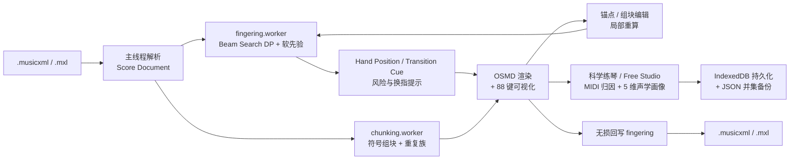

# MusicXML 钢琴自动指法

> 100% 运行在浏览器本地的 MusicXML 钢琴指法推导与交互练琴工作室：上传乐谱，自动推导 1–5 指法，点音符微调，接上电钢琴逐拍练习，最后无损导出带标准 `<fingering>` 标注的 MusicXML。零后端，乐谱不离开你的浏览器。

**中文** · [English](README.en.md)

[](https://www.typescriptlang.org/)
[](https://react.dev/)
[](https://vite.dev/)
[](https://vitest.dev/)
[](https://github.com/sunstrikes/auto-fingering/actions/workflows/ci.yml)
[](LICENSE)


*真实样本《武昌》73 小节、1290 个音符：Web Worker 内开启「模型辅助 (λ=0.85)」于 1405.9 ms 完成全曲指法推导（352 处换指提示），左侧为逐小节风险边栏，底部为组块拆合条、练琴走带与 88 键双手手位实时模拟。*

## 功能特性

- **自动指法推导与乐谱修复**：以 `Onset Slice`（同手同拍新击键）为单位运行 Beam Search 动态规划，统一处理双手/跨谱表、和弦、`Tie Continuation` 延音、`Grace Note` 倚音与既有指法锚点；可在「设置」中切换 `S` / `M` / `L` `Hand Span Profile`、开启「避免大拇指弹黑键」「优先保持手位稳定」，并内置默认开启的**「模型辅助(Beta)」预训练 Transformer 软先验**（纯 TS CPU 前向、懒加载 ~0.8 MB 权重，可调 `λ` 或切回经典求解，P0 物理跨度与锚点保持一票否决）；提供**乐谱修复建议**以定位并应用高风险跨度或指法微调。
- **双手 88 键与风险可视化**：五线谱内联指法气泡、`Hand Position` 色带、`Transition Cue`（穿指/跨指/移把/大跨度）与画布左侧逐小节风险边栏；支持多行分页与横向卷轴切换、缩放及 `<` `>` 警告跳转；底部 88 键共用键盘以靛蓝/青绿区分左右手，并用连续骨骼 SVG 模拟双手 `Hand Posture`。
- **智能组块拆合与检索锚点**：在独立 Web Worker（`chunking.worker`）中进行符号组块切分、重复族（`Passage Cluster`）识别与运动叠加分析；支持在小节线手动拆合（Split/Merge）及编辑 `Performance Cue` 检索锚点。
- **交互式微调**：停止状态下点击任意音符即可设锚点，在 Web Worker 中局部重算受影响乐句；支持 `phrase` / `pinOnly` 两种锚点语义、撤销/重做，以及 `Before → After` 变更对照。
- **自由练琴（Free Studio）**：
  - `0.25x–1.5x` 连续变速与等比 BPM 缩放，独立节拍器与 1 小节 `Count-In` 预备拍；
  - Web MIDI 电钢琴热插拔、端口选择、MIDI 本地发声开关与多种钢琴音色，以及无琴时的虚拟 88 键 / QWERTY 输入；
  - `Waiting Mode` 逐拍等待：累计命中（和弦先后落下）、同一音高防穿透、错音红色警示、倚音等待或跳过，以及严格模式开关；
  - `Practice Mode`：双手 / 只练右手（左手自动伴奏）/ 只练左手（右手自动伴奏）；
  - 整小节 `A-B Loop`，可插入每遍 1 小节空拍。
- **科学练琴（Guided Session）**：
  - 单曲时长制排课（`15 / 25 / 40 min`）、Macro Section 范围筛选、盲考、冷启动专项测验与全曲快速分诊；
  - 基于 `Motor-FSRS` 与 `MotorScheduler` 的交错调度、Stage 0 逐拍落键（`1 遍 ≥90%` 或 `2 分钟`上限自动毕业）、速度阶梯与过桥窗（`Bridge Window`）；
  - 零重排 OSMD SVG 渐隐脚手架（`L0–L3` 提示层级、L3 静音拍与 `B0` 1.5s 偷看指法）、可调预设的 `EHS` 眼手跨度遮罩、Micro-Rest / Early Macro-Rest 与听想预演（Audiation Priming）；
  - 支持用 `A0` / `A0+A#0` / `B0` / `C8` 琴键指令（及可选 `CC64` 延音踏板）全程免离手控制练习流。
- **5 维声学画像与外部聚焦教练**：通过 `Bounded Window Attribution` 在连续演奏后生成 5 维客观声学画像（节拍均匀度、声部突出度、连断奏、踏板清晰度、双手同步）与问题小节热点；`External-Focus Coach` 默认使用本地模板反馈，也支持可选 BYOK / PKCE 接入外部模型（仅发送结构化摘要，绝不上传原始 MIDI 时间戳）。
- **无损导入导出与本地持久化**：支持 `.musicxml` / `.xml` / `.mxl`，保留原谱排版、`<direction>`、`<lyric>` 与已有 `<fingering>`，只回写标准 W3C MusicXML 的 `<notations><technical><fingering>`；使用 IndexedDB 缓存乐谱、锚点草稿与练习历史，支持跨设备 JSON 备份导出与并集重放合并。
- **MuseScore 导入 CLI**：提供 `npm run musescore:import`（`bin/musescore-import.mjs`），从 MuseScore 4 页面提取 SVG 与 MIDI 并转换为 `.musicxml` / `.mxl`。
- **纯本地隐私**：解析、求解、组块分析、声学画像、音频合成与导出全部在浏览器本地完成；DP 求解与符号组块放在 Web Worker，主线程保持流畅。


*科学练琴（Guided Session）Stage 0 逐拍落键视图：当前活动组块聚焦高亮、后续小节渐隐防干扰、底部显示 `A0+` 琴键指令徽标与 88 键手位指引。*

## 快速开始

环境要求：**Node.js `>=22.12.0`**（Vite 8 / Vitest 5 工具链要求）与 npm。

```bash
git clone git@github.com:sunstrikes/auto-fingering.git
cd auto-fingering
npm install
npm run dev
```

打开 <https://localhost:5173>（本地启用自签 HTTPS 以支持 Web MIDI），上传 [`test-corpus/`](test-corpus/) 里的任一示例（`01`–`05`）即可看到自动指法结果。

构建与本地预览：

```bash
npm run build
npm run preview
```

## 使用流程

1. **导入乐谱**：点击「上传 .musicxml / .mxl」选择文件；解析在主线程完成，随后在 Web Worker 中自动完成指法求解与组块分析。
2. **调整手型、偏好与设置**：在右上角「设置」中切换 `S` / `M` / `L` 手型、「尽量避免大拇指弹黑键」「优先保持手位稳定」、`模型辅助(Beta)` 开关与 `λ` 权重，或勾选顶栏「忽略原谱已有指法」重算；如有高风险跨度可打开「乐谱修复建议」。
3. **查看、拆合组块与微调**：选择多行分页或横向卷轴浏览，点击 `<` `>` 在警告/高风险之间跳转；点击「组块拆合 · 检索锚点 · 编辑」微调分段与提示语；停止状态下点击音符设置锚点并局部重算。
4. **练琴**：在 **Free Studio** 中使用底部走带条（倍速、节拍器、等待模式、A-B 循环）自由练习；或点击顶栏 **「科学练琴 (Guided)」** 进入单曲排课、Stage 0 落键、渐隐脚手架、EHS 与 5 维声学画像反馈流程。
5. **备份与导出**：通过「练习备份」导出/合并跨设备 JSON 进度；点击「下载」导出 `.musicxml` 或 `.mxl`，指法以标准 `<fingering>` 标签写回，其他记号保持不变。

## 技术架构



| 层 | 选型 |
| --- | --- |
| UI | React 19 + TypeScript（strict）+ Tailwind CSS 4 |
| 构建 | Vite 8（Rolldown）+ Web Worker（`fingering.worker` / `chunking.worker`） |
| 乐谱渲染 | [OpenSheetMusicDisplay](https://opensheetmusicdisplay.org/) + 零重排 SVG 渐隐 / EHS 遮罩 |
| 状态与历史 | Zustand（`useStudioStore` / `useGuidedSessionStore`，含撤销/重做） |
| 本地持久化 | IndexedDB（`indexedDbStorage`）+ 跨设备 JSON 并集重放合并（`backupMerge`） |
| 容器读写 | JSZip（`.mxl` 的 `STORE` mimetype 约束） |
| 音频 | Web Audio API + [smplr](https://github.com/danigb/smplr) 采样，失败时退回内置泛音合成 |
| 外设 | Web MIDI API（热插拔、端口选择）+ 虚拟 88 键 / QWERTY 兜底 + 琴键指令路由 |
| 测试 | Vitest + jsdom + Chrome Playwright 浏览器回归脚本 |

## 目录结构

```text
bin/
└── musescore-import.mjs # MuseScore 4 导入 CLI 入口
src/
├── domain/              # 领域模型与纯数据契约（NoteEvent / OnsetSlice / PracticeStep ...）
├── musicxml/            # 解析、无损回写、乐谱修复写回、.mxl 容器读写
├── solver/              # 束搜索 DP、代价模型、手位与过渡推导、局部锚点重算、乐谱修复建议
├── prior/               # 预训练 Transformer 指法软先验（26×5 特征适配、纯 TS 前向与懒加载）
├── chunking/            # 符号组块静态分析、运动叠加分析、手动拆合覆盖
├── guided/              # 科学练琴内核（Motor-FSRS、交错调度、声学画像、EHS、渐隐脚手架、琴键指令等）
├── coach/               # 闭世界外部聚焦教练（本地模板、摘要载荷、校验与 BYOK 适配器）
├── workers/             # fingering.worker & chunking.worker 入口与强类型 RPC
├── audio/               # 钢琴音源、节拍器、播放/片段时钟/等待/A-B 循环调度
├── midi/                # Web MIDI 热插拔、端口选择、软件输入、环形缓冲与会话采集
├── persistence/         # IndexedDB 持久化、草稿重映射、多设备 JSON 并集备份合并
├── store/               # Zustand 全局状态（Studio / Guided Session）、Undo/Redo、Diff
├── hooks/               # 持久化、乐谱生命周期、组块分析、科学练琴与外部教练控制 Hook
├── components/          # ScoreViewer / UnifiedPiano88 / GuidedSessionLaunchCard / PracticeSettingsModal ...
├── practice/            # 等待模式状态机、练习步进投影与练习统计
└── musescore/           # MuseScore 4 SVG/MIDI 解析、对齐与 MusicXML 4.0 构建
scripts/                 # Chrome Playwright 端到端验收与多视口布局回归脚本
tests/                   # Vitest 单元测试与 test-corpus 回归门禁
docs/                    # ADR、设计方案、截图与部署说明
test-corpus/             # 01–05 回归样本（含真实曲目《武昌》）与 ms4-fixtures
```

## 开发脚本

| 命令 | 说明 |
| --- | --- |
| `npm run dev` | 启动 Vite 开发服务器（默认 <https://localhost:5173>） |
| `npm run build` | 生产构建到 `dist/` |
| `npm run preview` | 预览生产构建（默认 <https://localhost:4173>） |
| `npm run typecheck` | `tsc --noEmit` 类型检查 |
| `npm test` | 运行全部 Vitest 用例 |
| `npm run musescore:import` | 运行 MuseScore 4 转 MusicXML CLI（`bin/musescore-import.mjs`） |
| `npx vitest run --coverage` | 生成覆盖率报告（`coverage/`） |

## 测试与回归门禁

回归样本位于 [`test-corpus/`](test-corpus/)，固定了以下验收标准（详见 [SPEC.md](SPEC.md) 第 7 节）：

- 硬约束零违规：既有 `Finger Anchor`（无物理冲突时）遵循率 100%，`Tie Continuation` 不写指法，同手同拍无非允许重指冲突。
- 性能预算：真实样本《武昌》（73 小节、1290 击键音符）经典 DP 全曲求解 ≤ 200 ms，单次局部锚点重算 ≤ 20 ms。
- 导出兼容：回写后的 `.musicxml` / `.mxl` 在 OSMD 与 piano.cishoon.top 中正常加载，`<lyric>`、`<direction>`、`<slur>` 等原谱信息无损。
- 交互练琴与科学练琴：节拍器与预备拍、等比调速、Web MIDI 事件解析、等待模式状态机、A-B 循环、符号组块、Motor-FSRS、声学画像、EHS 遮罩与渐隐脚手架均有独立单元测试。
- 性能预算在本地保持 SPEC 原值；CI 共享 runner 上通过 `PERF_BUDGET_SCALE`（默认 `3`）放宽，避免硬件抖动误报，可在本地覆盖该变量复现严格门禁。

浏览器端到端验收（需要本机 Chrome，可用 `CHROME_PATH` 指定路径，可用 `STUDIO_URL` 指定本地地址）：

- **M1 验收**（对 `npm run dev`，默认 `https://localhost:5173/`）：`node scripts/check-m1-browser.mjs`，验证模拟 MIDI 等待模式、`.mxl` 刷新恢复、乐谱修复撤销/重做及备份恢复。
- **M2–M5 科学练琴验收**（建议 `npm run build && npm run preview`，默认 `https://localhost:4173/`）：`node scripts/check-m2-m5-browser.mjs`，验证符号组块、拆合覆盖、启动卡、`A0+A#0` 暂停/恢复、L2/L3 零重排脚手架、`B0` 偷看、Micro-Rest、5 维声学画像、BYOK 教练（无密钥/原始时间戳泄漏）与 EHS 遮罩。
- **多视口布局回归**（对 `npm run dev`，默认 `https://localhost:5173/`）：`node scripts/check-score-layout-browser.mjs`，跨桌面（`2560×1320`、`1920×950`、`1440×900`）与 iPad 视口检查横向卷轴/多行分页、组块编辑器弹窗与防遮挡不变量。

## 部署

本项目是纯静态 SPA，`npm run build` 后把 `dist/` 部署到任意静态托管即可，无服务端依赖、无需 SPA 路由回退（单页应用只有根路径）。

- `.github/workflows/ci.yml`：在 Node 22/24 上运行类型检查、测试与生产构建。
- `.github/workflows/deploy-edgeone.yml`：打 `v*` tag 或手动触发，把 `dist/` 发布到 EdgeOne Pages；需配置 `EDGEONE_PAGES_API_TOKEN` secret（可选 `EDGEONE_PROJECT_NAME` 变量）。
- EdgeOne Pages 部署步骤、匿名预览与项目认领说明见 [docs/deployment-edgeone.md](docs/deployment-edgeone.md)。

## 文档

| 文档 | 内容 |
| --- | --- |
| [SPEC.md](SPEC.md) | 产品目标、数据契约、算法与验收门禁 |
| [GLOSSARY.md](GLOSSARY.md) | 领域术语表（中英对照） |
| [ADR-0001](docs/adr/0001-dual-hand-88key-timeline-studio.md) | 双手 88 键时间轴工作室架构决策 |
| [ADR-0002](docs/adr/0002-interactive-practice-midi-waiting-loop.md) | 交互练琴（节拍器/MIDI/等待模式/A-B 循环）架构决策 |
| [docs/chord-and-scale-fingering-plan.md](docs/chord-and-scale-fingering-plan.md) | 和弦与音阶指法优化方案 |
| [docs/octave-span-and-score-repair-plan.md](docs/octave-span-and-score-repair-plan.md) | 八度跨度与乐谱修复建议方案 |
| [docs/musescore-import-phase0.md](docs/musescore-import-phase0.md) | MuseScore 4 导入方案与实现说明 |
| [test-corpus/README.md](test-corpus/README.md) | 回归样本说明与预期结果 |

## 浏览器兼容与限制

- **Web MIDI** 目前仅 Chromium 系浏览器支持，且需要 HTTPS 或 `localhost`；Safari/Firefox 会提示不可用，可改用页面内 88 键或 QWERTY 虚拟输入。
- 面向钢琴双手谱，音域固定 A0–C8（88 键）；三行以上总谱、四手联弹、非钢琴乐器指法不在范围内。
- 首次播放会懒加载钢琴采样，网络不可用时自动退回 Web Audio 合成音，不影响指法功能。
- 指法结果由代价模型推导，仅作为练习参考；不同手型/演奏习惯可通过设置中的 `S`/`M`/`L` 与锚点自行调整。

## 许可与第三方声明

本项目基于 [Apache License 2.0](LICENSE) 发布，版权归 sunstrikes 所有（见 [NOTICE](NOTICE)）。

内置的「模型辅助(Beta)」功能使用了 [`@lumikey/piano-fingering-model`](https://github.com/lumikey/piano-fingering-model)（npm 声明 MIT）的 26-token 特征定义与预训练 Transformer 权重；上游训练数据包含 PIG 数据集（Eita Nakamura, Yasuyuki Saito, Kazuyoshi Yoshii, *"Statistical Learning and Estimation of Piano Fingering"*, Information Sciences, Vol. 517, pp. 68–85, 2020；该数据集仅限非营利/学术用途，本仓库不包含或分发任何 PIG 数据集文件）。详细合规说明及 `VITE_BUNDLE_PRIOR=0` 一键剥离权重开关见 [NOTICE](NOTICE)。
