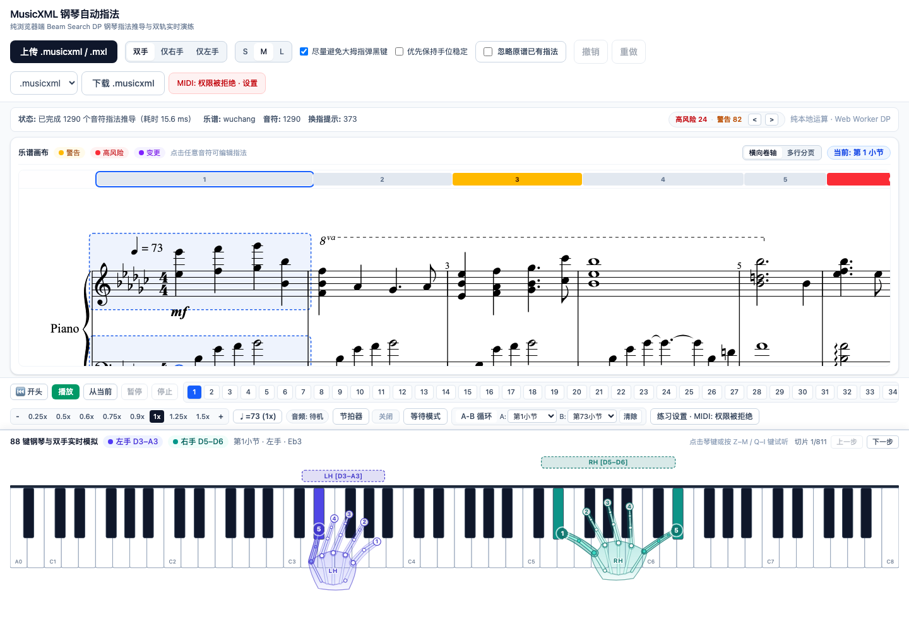
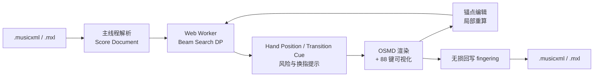

# MusicXML 钢琴自动指法

> 100% 运行在浏览器本地的 MusicXML 钢琴指法推导与交互练琴工作室：上传乐谱，自动推导 1–5 指法，点音符微调，接上电钢琴逐拍练习，最后无损导出带标准 `<fingering>` 标注的 MusicXML。零后端，乐谱不离开你的浏览器。

**中文** · [English](README.en.md)

[](https://www.typescriptlang.org/)
[](https://react.dev/)
[](https://vite.dev/)
[](https://vitest.dev/)
[](https://github.com/sunstrikes/auto-fingering/actions/workflows/ci.yml)



*真实样本《武昌》73 小节、1290 个音符：Web Worker 内 15.6 ms 完成全曲指法推导，右侧为小节风险小结，底部为 88 键双手手位与过渡提示。*

## 功能特性

- **自动指法推导**：以 `Onset Slice`（同手同拍新击键）为单位运行 Beam Search 动态规划，统一处理双手/跨谱表、和弦、`Tie Continuation` 延音、`Grace Note` 倚音与既有指法锚点；提供 `S` / `M` / `L` 三种 `Hand Span Profile`，以及「避免大拇指弹黑键」「优先保持手位稳定」两个偏好开关。
- **双手 88 键可视化**：五线谱内联指法气泡、`Hand Position` 色带、`Transition Cue`（穿指/跨指/移把/大跨度）与风险小结栏；底部 88 键共用键盘上用靛蓝/青绿区分左右手，并用连续骨骼 SVG 模拟双手 `Hand Posture`。
- **交互式微调**：停止状态下点击任意音符即可设锚点，在 Web Worker 中局部重算受影响乐句；支持 `phrase` / `pinOnly` 两种锚点语义、撤销/重做，以及 `Before → After` 变更对照。
- **交互练琴**：
  - `0.25x–1.5x` 连续变速与等比 BPM 缩放，独立节拍器与 1 小节 `Count-In` 预备拍；
  - Web MIDI 电钢琴热插拔、端口选择、MIDI 本地发声开关，以及无琴时的虚拟 88 键 / QWERTY 输入；
  - `Waiting Mode` 逐拍等待：累计命中（和弦先后落下）、同一音高防穿透、错音红色警示、倚音等待或跳过；
  - `Practice Mode`：双手 / 只练右手（左手自动伴奏）/ 只练左手（右手自动伴奏）；
  - 整小节 `A-B Loop`，可插入每遍 1 小节空拍。
- **无损导入导出**：支持 `.musicxml` / `.xml` / `.mxl`，保留原谱排版、`<direction>`、`<lyric>` 与已有 `<fingering>`，只回写标准 W3C MusicXML 的 `<notations><technical><fingering>`，可直接导入 MuseScore、[piano.cishoon.top](https://piano.cishoon.top) 等工具。
- **纯本地隐私**：解析、求解、音频合成与导出全部在浏览器完成；DP 求解放在 Web Worker，主线程保持流畅。

## 快速开始

环境要求：**Node.js `>=22.12.0`**（Vite 8 / Vitest 5 工具链要求）与 npm。

```bash
git clone git@github.com:sunstrikes/auto-fingering.git
cd auto-fingering
npm install
npm run dev
```

打开 <http://localhost:5173>，上传 [`test-corpus/`](test-corpus/) 里的任一示例（`01`–`05`）即可看到自动指法结果。

构建与本地预览：

```bash
npm run build
npm run preview
```

## 使用流程

1. **导入乐谱**：点击「上传 .musicxml / .mxl」选择文件；解析在主线程完成，随后自动进入求解。
2. **选择手型与偏好**：按实际手型切换 `S` / `M` / `L`；需要时开启「尽量避免大拇指弹黑键」「优先保持手位稳定」，或「忽略原谱已有指法」重算。
3. **查看与微调**：横向卷轴或多行分页浏览；点击 `<` `>` 在警告/高风险之间跳转；停止状态下点击音符设置锚点并局部重算。
4. **练琴**：在走带条选择倍速、开关节拍器/等待模式/A-B 循环，接入电钢琴（Web MIDI）或直接用虚拟键盘。
5. **导出**：选择 `.musicxml` 或 `.mxl` 下载，指法以标准 `<fingering>` 标签写回，其他记号保持不变。

## 技术架构



| 层 | 选型 |
| --- | --- |
| UI | React 19 + TypeScript（strict）+ Tailwind CSS 4 |
| 构建 | Vite 8（Rolldown）+ Web Worker |
| 乐谱渲染 | [OpenSheetMusicDisplay](https://opensheetmusicdisplay.org/) |
| 状态与历史 | Zustand（含撤销/重做） |
| 容器读写 | JSZip（`.mxl` 的 `STORE` mimetype 约束） |
| 音频 | Web Audio API + [smplr](https://github.com/danigb/smplr) 采样，失败时退回内置泛音合成 |
| 外设 | Web MIDI API（热插拔、端口选择）+ 虚拟键盘兜底 |
| 测试 | Vitest + jsdom |

## 目录结构

```text
src/
├── domain/        # 领域模型与纯数据契约（NoteEvent / OnsetSlice / PracticeStep ...）
├── musicxml/      # 解析、无损回写、.mxl 容器读写
├── solver/        # 束搜索 DP、代价模型、手位与过渡推导、局部锚点重算
├── workers/       # Web Worker 入口与强类型 RPC（新请求自动取消旧请求）
├── audio/         # 钢琴音源、节拍器、播放/等待/A-B 循环调度
├── midi/          # Web MIDI 热插拔、端口选择、软件输入适配
├── store/         # Zustand 全局状态、Undo/Redo、Diff
├── components/    # ScoreViewer / NoteAnchorPopover / TransportPracticeBar / UnifiedPiano88 ...
└── practice/      # 等待模式状态机与练习步进投影
tests/             # Vitest 单元测试与 test-corpus 回归门禁
docs/              # ADR 与部署说明
test-corpus/       # 01–05 回归样本（含真实曲目《武昌》）
```

## 开发脚本

| 命令 | 说明 |
| --- | --- |
| `npm run dev` | 启动 Vite 开发服务器（默认 5173） |
| `npm run build` | 生产构建到 `dist/` |
| `npm run preview` | 预览生产构建 |
| `npm run typecheck` | `tsc --noEmit` 类型检查 |
| `npm test` | 运行全部 Vitest 用例 |
| `npx vitest run --coverage` | 生成覆盖率报告（`coverage/`） |

## 测试与回归门禁

回归样本位于 [`test-corpus/`](test-corpus/)，固定了以下验收标准（详见 [SPEC.md](SPEC.md) 第 7 节）：

- 硬约束零违规：既有 `Finger Anchor`（无物理冲突时）遵循率 100%，`Tie Continuation` 不写指法，同手同拍无非允许重指冲突。
- 性能预算：真实样本《武昌》（73 小节、1290 击键音符）全曲求解 ≤ 200 ms，单次局部锚点重算 ≤ 20 ms。
- 导出兼容：回写后的 `.musicxml` / `.mxl` 在 OSMD 与 piano.cishoon.top 中正常加载，`<lyric>`、`<direction>`、`<slur>` 等原谱信息无损。
- 交互练琴：节拍器与预备拍、等比调速、Web MIDI 事件解析、等待模式状态机、A-B 循环均有独立用例。
- 性能预算在本地保持 SPEC 原值；CI 共享 runner 上通过 `PERF_BUDGET_SCALE`（默认 `3`）放宽，避免硬件抖动误报，可在本地覆盖该变量复现严格门禁。

## 部署

本项目是纯静态 SPA，`npm run build` 后把 `dist/` 部署到任意静态托管即可，无服务端依赖、无需 SPA 路由回退（单页应用只有根路径）。

- `.github/workflows/ci.yml`：在 Node 22/24 上运行类型检查、测试与生产构建。
- `.github/workflows/deploy-edgeone.yml`：打 `v*` tag 或手动触发，把 `dist/` 发布到 EdgeOne Pages；需配置 `EDGEONE_PAGES_API_TOKEN` secret（可选 `EDGEONE_PROJECT_NAME` 变量）。
- EdgeOne Pages 部署步骤、匿名预览与项目认领说明见 [docs/deployment-edgeone.md](docs/deployment-edgeone.md)。

## 文档

| 文档 | 内容 |
| --- | --- |
| [SPEC.md](SPEC.md) | 产品目标、数据契约、算法与验收门禁 |
| [GLOSSARY.md](GLOSSARY.md) | 领域术语表（中英对照） |
| [ADR-0001](docs/adr/0001-dual-hand-88key-timeline-studio.md) | 双手 88 键时间轴工作室架构决策 |
| [ADR-0002](docs/adr/0002-interactive-practice-midi-waiting-loop.md) | 交互练琴（节拍器/MIDI/等待模式/A-B 循环）架构决策 |
| [test-corpus/README.md](test-corpus/README.md) | 回归样本说明与预期结果 |

## 浏览器兼容与限制

- **Web MIDI** 目前仅 Chromium 系浏览器支持，且需要 HTTPS 或 `localhost`；Safari/Firefox 会提示不可用，可改用页面内 88 键或 QWERTY 虚拟输入。
- 面向钢琴双手谱，音域固定 A0–C8（88 键）；三行以上总谱、四手联弹、非钢琴乐器指法不在范围内。
- 首次播放会懒加载钢琴采样，网络不可用时自动退回 Web Audio 合成音，不影响指法功能。
- 指法结果由代价模型推导，仅作为练习参考；不同手型/演奏习惯可通过 `S`/`M`/`L` 与锚点自行调整。

## 许可

本仓库暂未添加开源许可证。如需复用、分发或商用，请先联系作者。
