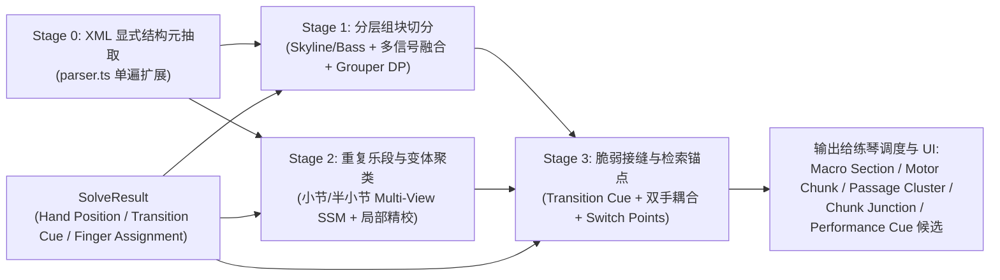

# 纯符号 MusicXML 曲式组块、重复乐段与脆弱接缝识别调研报告

> **关联工单**：[#12](https://github.com/sunstrikes/auto-fingering/issues/12)（Wayfinder 父地图 [#11](https://github.com/sunstrikes/auto-fingering/issues/11)，服务下游决策票 [#17](https://github.com/sunstrikes/auto-fingering/issues/17)）  
> **研究约束**：100% 纯浏览器本地离线（零后端、无外部音频对齐、无重型神经网络推理依赖），直接复用现有 `Score Document`（MusicXML 无损解析）与指法求解结果（`Hand Position`、`Transition Cue`、`Finger Assignment`），面向 70–200 小节（约 1,500–4,000 `Note Event`）的进阶独奏钢琴曲目。

---

## 1. 执行摘要与推荐架构

面向「离线浏览器 + 进阶钢琴独奏曲目 + 刻意练习闭环」的目标场景，经对计算音乐学、符号音乐信息检索（Symbolic MIR）及运动神经科学一手文献的系统评估，**不建议**采用高阶几何点集压缩算法（如 $O(kN^3)$ 的 SIATEC/COSIATEC）或需要外部训练权重的图神经网络（GNN）来解决曲式与组块识别问题。

我们推荐一套**确定性四阶段纯符号分析管线（Deterministic 4-Stage Symbolic Analysis Pipeline）**，在现有 Web Worker 体系中以纯 TypeScript + `TypedArray` 实现，面向 200 小节 / 4,000 `Note Event` 的长曲目可将总分析耗时控制在 **25–50 ms**、峰值内存控制在 **< 6 MB**：

核心结论速览：
1. **符号分段（问题 1）**：单一局部边界检测（如原始 LBDM）在钢琴复调双手谱上极易受分解和弦、阿尔贝蒂低音与双手错位呼吸的噪声干扰；单纯依赖终止式检测会漏掉大量半终止（Bigo et al., 2018 实证 HC $F_1$ 仅 `0.29`）。最优离线方案是 **MusicXML 显式结构标记（硬边界）+ Skyline/Bass 声部分离 + 改进 LBDM/GTTM 表面特征 + 轻量和声变化/终止式代理 + `Hand Position` 重置融合 + Temperley Grouper 风格动态规划（DP）**，同步产出「宏观乐段（4–16 小节）」与「运动组块 `Motor Chunk`（默认 2–4 小节）」双层粒度。
2. **近似重复与高杠杆乐段簇（问题 2）**：相比音符级 $O(N^3)$ 点集算法，基于 `Measure Timeline` 网格的**多视图移调不变自相似矩阵（Multi-View Transposition-Invariant SSM）**配合对角线路径提取（Müller & Jiang, 2012）与局部 Mongeau–Sankoff 音符级精校，既能稳健发现移调再现与装饰变体，又能利用本仓库独有的 `Finger Assignment` 评估**指法同构率（运动迁移相似度）**，避免高估「白键调移至黑键调」的练琴复用率；并可直接从重复路径的末端分叉处精准提取 **Chaffin Switch Points**。
3. **脆弱接缝预判与 Chaffin 锚点（问题 3）**：结合 Shih, Hirano & Furuya（*iScience*, 2025/2026）的组块接缝扰动机制与 Chaffin & Imreh（2002）的专家记忆检索结构，将跨边界前后 2–4 个 `Practice Step` 窗口内的 **6 维特征**（`Transition Cue` 危险度与速度、`Hand Position` 盲跳幅度、双手同时移把/非整数复节奏耦合、`Held Finger` 占用压力、Switch Point 记忆分叉干扰、以及运行期 `practiceAnalytics.ts` 实测犹豫/错音后验）统一建模为接缝风险分，并以非极大值抑制（每 4–8 小节至多 1 个主锚点）筛选高信噪比 `Performance Cue`。
4. **复杂度与内存（问题 4）**：利用小节/半小节帧级 `Float32Array` 矩阵（$M \le 200 \Rightarrow M^2 \le 40{,}000$ 单元 $\approx 160\text{ KB}$），并实现「乐谱结构静态层」与「指法依赖动态层」两级缓存解耦，用户在 UI 调整 `Finger Anchor` 触发 `local-resolve` 时无需重算 SSM，仅需 `< 2 ms` 刷新接缝风险。

---

## 2. 仓库现状盘点：已有资产、未提取信息与 ADR 边界

在设计新算法前，先核对本仓库现有数据模型（`src/domain/types.ts`、`src/musicxml/parser.ts`、`src/solver/solveFingering.ts`、`src/practice/practiceAnalytics.ts`）与已采纳的 ADR（`docs/adr/0001`、`0002` 及工作区预训练先验设计 `ADR-0003`）：

### 2.1 已有可用资产

| 现有领域概念 / 模块 | 当前已提供的数据与能力 | 对曲式组块与接缝识别的价值 |
| :--- | :--- | :--- |
| `Score Document` (`src/domain/types.ts`) | 无损 `xmlDoc: Document`、`noteEvents`、`onsetSlices`、`measureTimelines`、`tempoPoints`、`timeSignaturePoints`、`pedalIntervals`、`ticksPerQuarter` | 完整保留时间轴、拍号、速度变化、弱起小节（`isPickup`）与踏板区间，无需重复解析时间网格 |
| `Note Event` & `Tie Continuation` | `midi`、`onsetTick`、`durationTick`、`onsetSec`、`durationSec`、`hand`、`voice`、`staff`、`isGrace`、`isTieStop`、`isTieStart`、`isArpeggiated` | 已自动剔除延音连接（`isTieStop`）并合并连音链总时值，天然消除装饰音与跨小节延音造成的伪分段 |
| `Onset Slice` & `phraseId` (`parser.ts#L871-891`) | 按 `(hand, onsetTick, graceOrder)` 聚合，保留 `heldNotes`（含 `pedalSustained` 标记） | `heldNotes` 可直接衡量物理占指压力；**但现有 `phraseId` 仅在反复记号/跳房子、全小节休止或 `>= 1.5s` 静默时递增**，在连绵不断的织体（如巴赫赋格、肖邦练习曲、无休止琶音）中整曲可能只有一个 `phraseId = 0`，**绝不可直接作为 `Motor Chunk`** |
| `Hand Position` (`solveFingering.ts#L1504-1550`) | 五指把位区间 `[thumbKey..pinkyKey]` 与 `[startSliceId..endSliceId]`，在发生穿指/跨指、`rootShift >= 2.0`、`noOverlap` 或掌宽超过 7 白键时切分 | 天然反映单手物理把位稳定性，是「把位切换型边界」的极佳现成特征 |
| `Transition Cue` (`solveFingering.ts#L1245-1502`) | 6 类结构化技术提示：`thumb-under`、`cross-over`、`position-shift`（含 `velocity = rootShift / dt` 物理速度分级）、`wide-stretch`、`unreachable-span`、`anchor-conflict`，含 `severity` 与 `cost` | 构成脆弱接缝物理难度的核心先验，直接复用零额外求解开销 |
| `Practice Step` & `practiceAnalytics.ts` | 跨手同步的 `Practice Step` 序列；运行期记录 `pitchErrors`、`durationErrors`、`hesitationCount`（阈值 `1.6x` 预期时距且 `>= 0.45s`） | 提供练琴后的**后验实证信号**，实现「静态预判 + 个体实测」闭环校准 |

### 2.2 `xmlDoc` 中已无损保留但尚未抽取的 MusicXML 4.0 结构信号

依据 W3C MusicXML 4.0 规范（W3C Music Notation Community Group, 2021），以下高信噪比显式曲式标记在钢琴乐谱中极为常见，目前虽存在于 `ScoreDocument.xmlDoc` 中，但 `src/musicxml/parser.ts` 尚未提取到结构化字段：

- **显式段落与反复标记**：`<barline>` 下的 `<bar-style>`（双纵线 `light-light`、终止线 `light-heavy`）、`<repeat direction="forward">`（目前仅处理了 `backward`）、`<direction-type>/<rehearsal>`（排练号如 `[A]`、`[B]`）以及 `<sound segno/coda/dacapo/dalsegno>`。
- **调号与和声标记**：`<attributes>/<key>`（`<fifths>` 与 `<mode>`，曲中转调是极强的宏观乐段边界）、可选的 `<harmony>` 和弦符号。
- **句法与呼吸标记**：`<notations>/<slur type="start|stop|continue">`（乐句连线起止，直接对应 GTTM GPR 2a）、`<notations>/<fermata>` 与 `<barline>/<fermata>`（延长号/气口，极高权重边界）。
- **力度与表情突变**：`<direction-type>/<dynamics>`（`pp`–`ff`、`fp`、`sfz`）、`<wedge>`（渐强/渐弱收束）、`<words>`（如 *a tempo*、*rit.*、*dolce*、*subito p*）。

> **Web Worker 序列化约束**：`ScoreDocument.xmlDoc` 是浏览器 DOM 对象，无法通过 `postMessage` 传递至 Web Worker（ADR-0002 也刻意约束 Worker 仅接收纯数据对象）。因此，建议在 `parseMusicXml` 的单遍 DOM 扫描中顺带产出扁平、可结构化克隆的 `MeasureStructuralMeta[]` 与 `SlurSpan[]`，开销 `< 3 ms`，彻底避免在 Worker 中重复解析 XML。

### 2.3 与现有 ADR 的边界关系与张力提示

> _需在下游决策票 [#17](https://github.com/sunstrikes/auto-fingering/issues/17) 明确协调的接口张力（对照 [ADR-0002](../adr/0002-interactive-practice-midi-waiting-loop.md)）：_
> 1. **整小节 `A-B Loop` vs 跨边界微桥接窗口**：ADR-0002 规定 `A-B Loop` 为闭区间整小节 `[startMeasureIndex, endMeasureIndex]`。然而 Shih, Hirano & Furuya (2025) 证实脆弱接缝集中在跨组块边界的 2–4 个连续动作事件处；若仅按整小节循环，用户每次必须重弹整个前小节才能到达接缝，违背聚焦桥接原则。建议保留现有整小节 `A-B Loop`（服务阶段 0 自由练习），同时在决策票 #17 审慎评估新增基于 `Practice Step` 索引范围的微桥接区间（`Bridge Window`）。
> 2. **Worker 协议扩展（对照纯 TS 轻量推理原则）**：`src/workers/fingering.worker.ts` 现已承载启发式求解与可选的纯 TS 轻量 Transformer 先验。新增结构分析任务应与指法求解结果共享 Worker（或按需加载纯 TS 分析模块），严禁引入大型 WASM/ONNX 运行时。

---

## 3. 问题一：纯符号音乐分段在钢琴双手谱上的准确度与边界噪声

### 3.1 一手理论基础与实证基准

#### (1) GTTM 群组偏好规则（Lerdahl & Jackendoff, 1983）
Lerdahl & Jackendoff 在 *A Generative Theory of Tonal Music* (MIT Press, 1983) 中提出了人类听觉切分音乐表面的经典 **Grouping Preference Rules (GPR)**，其中可直接从符号乐谱计算的局部与全局规则包括：
- **GPR 2（邻近性 Proximity）**：`2a` 连线/休止间隔（Slur/Rest，对应 MusicXML `<slur>` 与休止时值）、`2b` 起音间隔（Attack-Point / IOI，长音或慢节拍后易形成边界）。
- **GPR 3（变化性 Change）**：`3a` 音区跳变（Register）、`3b` 力度突变（Dynamics）、`3c` 奏法变化（Articulation）、`3d` 时值模式改变（Length）。
- **GPR 5（对称性 Symmetry）**：人类倾向将乐段均分为对称长度（如 2+2、4+4 小节）。
- **GPR 6（平行性 Parallelism）**：两个平行/重复片段的起点应具有一致的群组边界地位（直接与问题二重复检测联动！）。

#### (2) LBDM 局部边界检测模型（Cambouropoulos, 2001）
Cambouropoulos（ICMC 2001, *"The Local Boundary Detection Model (LBDM) and its Application in the Study of Expressive Timing"*）将 GTTM 局部规则形式化为简洁的无监督算子。对任意单一特征序列 $x_1, x_2, \dots, x_m$（分别取**音程绝对值 pitch interval**、**相邻起音时距 IOI**、**休止时值 rest**），定义：
- **变化规则（Change Rule）**：
  $$r_{i,i+1} = \begin{cases} \dfrac{|x_i - x_{i+1}|}{x_i + x_{i+1}}, & x_i + x_{i+1} > 0 \\ 0, & \text{otherwise} \end{cases}$$
- **邻近规则（Proximity Rule）**：
  $$s_i = x_i \cdot (r_{i-1,i} + r_{i,i+1})$$
- **归一化加权融合**：将三路曲线各自归一化到 $[0, 1]$ 后线性组合（Cambouropoulos 2001 基准权重：$w_{\text{pitch}} = 0.25,\; w_{\text{ioi}} = 0.50,\; w_{\text{rest}} = 0.25$）：
  $$S(i) = 0.25\,\tilde{s}_{\text{pitch}}(i) + 0.50\,\tilde{s}_{\text{ioi}}(i) + 0.25\,\tilde{s}_{\text{rest}}(i)$$

#### (3) Temperley *Grouper* 动态规划与单声部实证上限
Temperley（2001, *The Cognition of Basic Musical Structures*, MIT Press, Ch. 3）指出，纯局部阈值法（如直接对 LBDM 取局部极大值）缺乏对**乐句合理长度**与**节拍平行性**的约束，极易产生 2 个音符的碎片或长达 20 小节的巨块。他的 *Grouper* 模型采用**动态规划（DP）**求全局最优切分：同时奖励间隔分（GPR 2，音符结束到下一音符起音的 IOI/OOI）、惩罚偏离理想长度（GPR 5，对数惩罚）并奖励相邻乐句起始节拍位置一致（GPR 6 节拍平行性）。

Pearce, Müllensiefen & Wiggins（2010, *Advances in Music Information Retrieval*, Springer）在标准 Essen 民歌库（EFSC）上的系统对比表明：**即便在相对简单的单声部旋律上，纯局部 LBDM 与 Grouper 的 $F_1$ 分数大约在 `0.50–0.66` 区间**（LBDM 与 IDyOM 均跨过 `0.50`，融合多特征后有所提升）。Hartmann, Lartillot & Toiviainen（2017, *JNMR*）进一步表明，在复调音乐中单靠表面局部特征难以解释专业演奏者感知的深层结构边界，特征间的**交互项（Interaction Features，如时值停顿 + 和声稳定 + 节拍强位同时出现）**显著提升预测力。

#### (4) 复调和声与终止式检测的现实边界
Temperley（2001, Ch. 3.6 & Ch. 6）指出，在复调钢琴作品中，**主旋律优先（Melodic Prime）**与**和声终止式（Cadential Closure）**是统摄双手分组的关键。针对符号乐谱的终止式自动检测，Bigo, Feisthauer, Giraud & Levé（ISMIR 2018, *"Relevance of Musical Features for Cadence Detection"*）在 Haydn 弦乐四重奏与 Bach《平均律》第一册（WTC I）上用 44 维符号特征（`XYZR`，包含当前到达和弦 `Z`、前导两步上下文 `X, Y` 与节奏特征 `R`）评测了 SVM 分类器（见原文 Table 3）：

| 特征集 | Haydn 四重奏 (PAC $F_1$) | Haydn 四重奏 (HC $F_1$) | Bach WTC I (PAC $F_1$) | Bach WTC I (PAC+rIAC $F_1$) |
| :--- | :---: | :---: | :---: | :---: |
| 全部特征 (`XYZR`) | **0.69** | **0.29** | **0.80** | **0.68** |
| 仅到达点+节奏 (`ZR`) | 0.59 | 0.24 | 0.52 | 0.34 |

Karystinaios & Widmer（ISMIR 2022）用图神经网络（GraphSMOTE GCN）将音符/休止建图为节点分类任务，在免去手工特征的情况下达到了与特征工程 SVM 相当的水平，但仍强依赖监督标注训练权重。

**关键启示**：
1. 即使是有监督 ML/GNN，**半终止（Half Cadence, HC）的 $F_1$ 也仅约 `0.29`**——而钢琴曲大量乐句（尤其是 4+4 乐段的前半句）恰好以半终止收束！因此，**绝不能指望单独的终止式检测来划分乐句**，终止式（特别是易用规则近似的 V→I 低音五度下行 + 强拍到达 + 和声节奏放缓）只应作为多通道融合的加分项（Bonus）。
2. 轻量无监督和声特征完全可行：利用 **Krumhansl-Schmuckler / Temperley 调性轮廓（Temperley, 1999, *Music Perception*）**与 **HarmAn 模板匹配（Pardo & Birmingham, 2002, *Computer Music Journal*）**，每半小节计算 24 个大/小三和弦模板得分与低音根音运动，即可在 `< 1 ms` 内提取「和声节奏变化、属-主解决倾向（V→I / V7→I）、以及局部转调」三大强边界线索。

#### (5) 运动神经科学对「组块粒度」的硬约束
与纯音乐学曲式分析不同，我们的核心下游消费者是**钢琴运动学习**。一手运动控制研究给出了清晰的认知容量锚点：
- **Palmer & van de Sande (1995, *JEP: HPP*)** 与 **Palmer & Pfordresher (2003, *Psychological Review*)** 通过钢琴演奏序列错音实验证明，熟练演奏者的增量运动规划跨度（Range of Planning）约为 **3–6 个序列化事件**（通常对应 1–2 拍至 1–2 小节），超过边界后规划激活度快速衰减。
- **Sakai, Kitaguchi & Hikosaka (2003, *Experimental Brain Research*)** 与 **Loehr & Palmer (2007, *Experimental Brain Research*)** 证明，人在学习长按键序列时会自发形成受生物力学约束与节拍层级共同塑造的层级化 **Motor Chunk**，且块与块之间的时间间隔显著长于块内。
- **结论**：音乐学的 8–16 小节乐段（Macro Section）过长，远超工作记忆与运动规划缓冲；而 LBDM 直接切出的 2–3 音动机又过于琐碎。必须输出**两级嵌套结构**：
  - **Macro Section（宏观乐段）**：4–16 小节，用于曲式地图、重复簇复用视图与一级结构锚点；
  - **Motor Chunk（运动组块）**：默认 **2–4 小节**（快速密集织体如十六分音符跑动可收窄至 **1–2 小节**；慢板长音可放宽至 **4 小节**），直接映射单次刻意练习与穿插调度的原子训练单元。

---

### 3.2 钢琴双手谱上的 5 大边界噪声（Failure Modes）及抑制策略

将 monophonic LBDM/GTTM 直接套用到钢琴双行谱（Grand Staff）会出现严重失真，具体表现为 5 类高频噪声：

| # | 钢琴双手谱典型噪声场景 | 直接跑传统 LBDM/GTTM 的失效表现 | 本管线的针对性抑制策略 |
| :---: | :--- | :--- | :--- |
| 1 | **阿尔贝蒂低音 / 分解和弦伴奏**（如莫扎特奏鸣曲 LH、肖邦夜曲） | 音符间连续出现五度/八度大跳，LBDM 音程通道 $S_{\text{pitch}}$ 在伴奏内部高频炸峰 | **主旋律 Skyline + 低音 Bassline 声部分离**（Uitdenbogerd & Zobel, 1999）：仅对 RH 最高声部与 LH 最低声部计算旋律 LBDM；对等时值持续分解和弦（同和弦 Pitch-Class 集合内反复震荡），将 $w_{\text{pitch}}$ 衰减至 `0.05` |
| 2 | **双手错位呼吸**（右手乐句收尾休止，左手伴奏不停） | 双手合并时间轴上无绝对静默（`silenceGapSec = 0`），漏检真实乐句边界 | **分轨打分 + 非对称加权**：RH Skyline 休止/长音收束与 `<slur type="stop">` 独立贡献高权重（遵循 Temperley 2001 "Melodic Prime"），不要求 LH 同步休止 |
| 3 | **倚音装饰与跨小节延音线** | 装饰音导致 `IOI ≈ 0` 剧烈抖动；跨小节延音被误判为新起音 | 直接消费本仓库 `Score Document` 已净化的 `Onset Slice`（已排除 `Tie Continuation` `isTieStop` 且隔离 `isGrace`），天然免疫 |
| 4 | **永动织体 vs 浪漫派长呼吸**（如巴赫赋格/练习曲全曲等时值十六分音符，无休止无连线） | LBDM 的 IOI 与 Rest 通道全程趋近于 0，产生严重欠分割（整曲 1 块）或随机噪点 | 引入 **Temperley Grouper 风格全局 DP**（理想块长软约束）+ **和声变化/终止式代理** + **`Hand Position` 重置边界** + **Stage 2 重复平行起点（GPR 6）**，在无休止曲目中仍能沿乐句/和声/把位自然切块 |
| 5 | **严密复调对位交错**（巴赫赋格 Stretto，RH 与 LH 乐句边界错开 1–2 拍） | 双手无共同绝对边界，强行一刀切会截断另一只手的连奏动机 | 将切分候选限定在**小节线与次强拍（半小节）**，为每个边界附加 `confidence ∈ [0,1]` 与 `overlapFlag`；对高复调重叠边界，自动提示将其前后 2–4 步标记为需重点桥接的接缝 |

---

### 3.3 符号分段候选方案横向对比

| 方案 | 典型代表 | 双手钢琴适用性 | 边界噪声控制 | 离线/零模型开销 | 推荐定位 |
| :--- | :--- | :--- | :--- | :--- | :--- |
| **A. 纯局部规则 LBDM** | Cambouropoulos (2001) | 差（单声部假设） | 差（分解和弦误峰严重、永动曲目失效） | 极低 ($O(S)$) | 仅作单声部 Skyline 子特征通道 |
| **B. 纯终止式分类器 (SVM/GNN)** | Bigo et al. (2018); Karystinaios & Widmer (2022) | 中（擅长古典 PAC，漏检 HC 与非古典曲风） | 中（仅抓句尾，不管中间组块长度） | 需预训练权重/图推理（高） | 不单独采用；用无监督五度低音+和声代理替代 |
| **C. 纯统计信息熵模型 (IDyOM)** | Pearce et al. (2010) | 中（单声部表现优异，复调扩展复杂） | 中（需语料库长期模型 LTM 预训练） | 需随包携带语料 n-gram 模型 | 暂不作为首版必需，未来可作轻量选配 |
| **D. 仅靠指法 `Hand Position` 切分** | 本仓库 `derivePositionsAndCues` | 偏向纯物理动作 | 过碎（平均每 0.5–1.5 小节就换一次把位，破坏音乐语义） | 零额外开销 | 仅作边界融合通道之一与接缝风险源 |
| **E. 显式标记 + 多特征融合 + Grouper DP（推荐）** | GTTM + 改良 LBDM + HarmAn 代理 + `Hand Position` + Temperley DP | **优**（兼顾古典、浪漫、流行、动漫钢琴改编谱） | **优**（硬标记置顶 + DP 控块长 + 重复平行性对齐） | **极低**（纯 TS，`< 3 ms`） | **首选核心架构** |

#### 推荐融合打分与 DP 目标函数设计（供工程原型直接验证）
在所有候选边界点 $c \in \mathcal{C}$（取所有小节起止点及 4/4、6/8、12/8 等复合拍的半小节次强拍，共 $|\mathcal{C}| \le 2M$）上计算综合边界强度 $B(c) \in [0, 1]$：

1. **硬结构标记层（直接锁定 Macro Section 边界）**：
   - 双纵线 `light-light` / 反复线 `repeat` / 跳房子 `ending` / 排练号 `<rehearsal>` / 调号切换 `<key>` 变化 / 速度大变（`>= 20%` BPM 跳变或 *a tempo*）/ 拍号切换。
2. **软边界融合分 $B_{\text{soft}}(c)$**：
   $$B_{\text{soft}}(c) = \text{clamp}_{[0,1]}\Big( w_1 F_{\text{slur/fermata}}(c) + w_2 F_{\text{lbdm-skyline}}(c) + w_3 F_{\text{harmonic-cadence}}(c) + w_4 F_{\text{hand-reset}}(c) + w_5 F_{\text{parallel-ssm}}(c) + w_6 F_{\text{texture-change}}(c) \Big)$$
   - $F_{\text{slur/fermata}}$：MusicXML `<slur type="stop">` 恰好落在 $c$ 前且新 `<slur type="start">` 始于 $c$，或存在 `<fermata>`。
   - $F_{\text{lbdm-skyline}}$：RH Skyline（最高音）与 LH Bassline（最低音）分轨 LBDM 的加权融合（`0.7 RH + 0.3 LH`），长休止（`>= 1 拍`）加权提升。
   - $F_{\text{harmonic-cadence}}$：基于每半小节 12 维音高类加权向量的 HarmAn 根音估计，检测强拍上的 V→I（低音下行纯五度/上行纯四度且和声稳定）与和声节奏减缓（长时值到达）；同时利用 Foote (2000) 棋盘格核在自相似矩阵对角线上计算宏观新奇度峰值（Novelty Curve）。
   - $F_{\text{hand-reset}}$：在边界 $c$ 处 RH 或 LH 恰好结束旧 `Hand Position` 且开启新把位（且前一个音符时值非短促十六分音符连奏，避免在跑动穿指中间切碎乐句）。
   - $F_{\text{parallel-ssm}}$：来自 Stage 2 的重复起点回填（GTTM GPR 6：若多个重复乐段均对齐于 $c$ 的相对拍位，显著提升 $c$ 的边界置信度）。
   - $F_{\text{texture-change}}$：前后 1 小节的音符密度（`Onset Slice` 数/拍）、平均音高重心或复音数（平均和弦音数）发生阶跃变化。
3. **全局最优组块划分（Temperley Grouper 风格 DP）**：
   寻找切分序列 $0 = b_0 < b_1 < \dots < b_K = |\mathcal{C}|$，最大化：
   $$J(b_0, \dots, b_K) = \sum_{k=1}^{K} \Big[ B(b_k) - \alpha \cdot \Big(\log_2 \frac{\text{effDur}(b_{k-1}, b_k)}{\mu_{\text{chunk}}}\Big)^2 - \beta \cdot \mathbb{I}[\text{mid-bar}(b_k)] + \gamma \cdot \text{MeterSymmetry}(b_{k-1}, b_k) \Big]$$
   其中 $\text{effDur}$ 结合小节数与音符密度（默认目标 $\mu_{\text{chunk}} \approx 2\text{–}4$ 小节或约 16–32 个 `Practice Step`，防止高速密集曲目切块过重、慢板稀疏曲目切块过碎），$\beta$ 对非小节线切分施加轻微惩罚（除非存在显著弱起 anacrusis 或强连线收尾）。

---

## 4. 问题二：近似重复、动机变体与「高杠杆乐段簇」检测

### 4.1 练琴视角下的重复检测需求定义

在音乐学 MIR 基准（如 MIREX *Discovery of Repeated Themes & Sections*，JKU-PDD 数据集）中，研究者常致力于挖掘 3–5 音的微观对位动机。但对于钢琴自学者而言，「学会 A 段即可复用 40% 进度」指向的是**中宏观尺度的可复用乐段簇（`Passage Cluster`，通常长度 $\ge 2$ 小节）**，且必须区分四种具有不同**练琴迁移价值**的重复形态：

1. **精确重复（Exact Repeat）**：同调、同旋律、同伴奏（例如奏鸣曲呈示部重复、流行/动漫曲的副歌 1 & 2）→ **运动复用率 ~95%–100%**。
2. **织体/装饰微变（Ornamented / Accompaniment Variant）**：旋律骨架或和声进行相同，仅左手伴奏加密（如八分音符变十六分分解）或右手加八度/倚音 → **运动复用率 ~65%–85%**。
3. **移调再现（Transposed Recapitulation / Sequence）**：如古典奏鸣曲副部在呈示部为属调（G 大调）、再现部移回主调（C 大调），或模进乐段 → **认知/乐理复用率高，但运动复用率取决于黑键地形是否同构！**（例如 C 大调移至 G 大调仅多 1 个黑键，指法同构率高；C 大调移至 F# 大调黑键排布巨变，指法几乎重构）。
4. **首同尾异的「重复分叉」（Divergent Repeat / Chaffin Switch）**：前 3–7 小节完全或高度一致，最后一拍突然转入不同走向（如 1 房子 vs 2 房子、巴赫意大利协奏曲 Presto 的经典分叉）→ **不仅可复用前段，其分叉点更是全曲头号记忆防撞锚点！**

### 4.2 一手算法深度对比

| 算法家族 | 代表一手文献 | 理论复杂度 | 复调与变体容忍度 | 浏览器离线适配度（$N=4000, M=200$） |
| :--- | :--- | :--- | :--- | :--- |
| **几何点集算法：SIA / SIATEC / COSIATEC** | Meredith, Lemström & Wiggins (2002, *JNMR*) | SIA: $O(kN^2 \log N)$；SIATEC: $O(kN^3)$ 时间、$O(kN^2)$ 空间 | 擅长精确平移（含精确移调），但**极怕装饰音增删与节奏微调**；易产生海量稀疏非紧凑伪模式 | **不推荐**：$N=4000$ 时向量对达 $8 \times 10^6$，纯 JS 内存极易飙升数百 MB 且耗时长达数秒至数十秒 |
| **改良点集指纹：SIARCT-CFP** | Collins, Arzt, Flossmann & Widmer (ISMIR 2013) | 最坏仍受限点集配对 $O(kN^3)$，经 Compactness Trawling 与哈希剪枝显著加速 | 支持不精确重复，在 MIREX JKU-PDD 基准表现领先（单算法平均 $F_1 \approx 0.35\text{–}0.61$） | **工程复杂度高**：实现与调参重，且其产出为碎片化点集而非天然对齐小节/组块的练习段落 |
| **符号音程 N-gram 倒排索引 + 局部比对** | Uitdenbogerd & Zobel (1999); Mongeau & Sankoff (1990) | 索引 $O(N)$，局部校验 $O(K \cdot L_1 L_2)$ | 擅长单声部旋律（Skyline）检索与分裂/合并变体，但容易漏掉「旋律微变但和声织体不变」的段落 | **适合作为精校层**：对已召回的候选对做音符级精确对齐与分叉定位 |
| **网格化多视图移调不变 SSM + 路径提取（推荐）** | Foote (2000, *ICME*); Müller & Jiang (2012, *ISMIR*); Müller (2015, *FMP* Ch. 4) | **$O(M^2)$ 或 $O((2M)^2)$**（$M$ 为小节数，独立于音符数 $N$！） | **极优**：支持移调不变、节奏/伴奏微调、自动导出层次化乐段簇与 Fitness 杠杆度 | **最优**：$M=200$ 时矩阵仅 `160 KB`（半小节 `640 KB`），Worker 内 `< 20 ms` 完成 |

### 4.3 推荐算法：小节/半小节四视图 SSM + 局部音符精校 + 指法同构加权

因为 MusicXML 天然提供了无误差的 `Measure Timeline` 与拍号，我们无需像音频 MIR 那样对抗自由速度（rubato）导致的帧漂移，可以直接以**半小节（或整小节）为分析帧**（帧数 $T \in [70, 400]$），每帧提取 4 个紧凑特征视图：

1. **视图 1：移调不变和声色度向量 $C_t \in \mathbb{R}^{12}$（Pitch-Class Duration Histogram）**
   - 统计帧内所有发声 `Note Event`（含跨越本帧的 `Tie Continuation` 持续时值）在 12 个半音类上的时值加权分布，L2 归一化。
   - 帧对 $(i, j)$ 的**最优移调相似度**与**移调半音偏移量 $\Delta^*_{ij}$**（Müller, 2015, Ch. 4）：
     $$S_{\text{chroma}}^{\text{TI}}(i, j) = \max_{\Delta \in \{0..11\}} \langle C_i,\; \text{rot}_\Delta(C_j) \rangle, \quad \Delta^*_{ij} = \arg\max_{\Delta} \langle C_i,\; \text{rot}_\Delta(C_j) \rangle$$
   - 精确重复时 $\Delta^* = 0$；属调/下属调再现时 $\Delta^* \in \{5, 7\}$ 且在整段对角线上保持**常量 $\Delta^*$**！这一约束可瞬间过滤偶然的随机和弦巧合。
2. **视图 2：RH Skyline 音程序列与轮廓向量 $I_t$（Pitch-Interval & Contour Signature）**
   - 提取帧内 RH 最高声部相邻非装饰音的有向半音差序列（例如 `[+2, +2, -1, +3]`）与三值轮廓码（Parsons 风格：`U/D/R`），用 2-gram / 3-gram 音程袋余弦相似度（天然**移调不变**）捕捉旋律主题变奏。
3. **视图 3：双手节奏网格位图 $R_t \in \mathbb{R}^{2 \times G}$（Rhythm Onset Grid，如 $G=12$ 或 $16$ 子拍）**
   - 将帧内 RH 与 LH 的起音时刻映射到归一化拍内相位网格（兼容二连音与三连音，取 12 或 24 细分，加轻微高斯平滑容忍微弱附点改动），直接识别节奏型完全相同的动机模进与伴奏型复用。
4. **视图 4：指法与把位同构指纹 $F_t$（Motor Transfer View — 本仓库独有！）**
   - 仅在已召回的相似段对 $(A, B)$ 上计算：比对两段对应 `Onset Slice` 上求解器产出的 `Finger Assignment` 序列一致率 $\rho_{\text{finger}}(A, B) \in [0, 1]$，以及 `Hand Position` 相对位移轮廓相关性。
   - **产品价值**：计算全曲「高杠杆复用率」时，以加权复用公式：
     $$\text{MotorReuse}(A \to B) = \begin{cases} 0.95, & \text{精确重复 } (\Delta^*=0,\; S_{\text{all}} \ge 0.92) \\ 0.40 \cdot S_{\text{music}}(A, B) + 0.60 \cdot \rho_{\text{finger}}(A, B), & \text{变体或移调再现} \end{cases}$$
     这样可向学习者透明展示：「学会 A 乐段簇（8 小节），可直接复用 24 小节（占全曲 30%）；其中第 65–72 小节为移调再现，指法同构率 62%，需额外留意黑键把位」。

#### 路径提取、聚类与 Switch Point 发现流程
1. **联合自相似矩阵与对角线路径增强**：融合视图 1–3 生成原始矩阵 $S(i, j)$（要求相邻对角点移调量 $\Delta^*$ 一致），沿主对角线平行方向做长度为 $L_{\text{filt}} = 4$ 帧的均值滤波（Path Enhancement，Müller 2015），显著压制孤立和弦巧合噪点、凸显连续重复乐段条纹。
2. **重复乐段提取与 Fitness 排序（借鉴 Müller & Jiang, 2012）**：
   - 从高于阈值 $\tau_{\text{sim}}$（建议 `0.78`）的对角线连通段提取重复路径（要求最小长度 $\ge 2$ 小节，容忍中间最多 1 帧局部低分以跨越 1 拍装饰变体）。
   - 用并查集 / 传递闭包将互为重复的区间归入同一 **`Passage Cluster`**，按 **Fitness / 杠杆覆盖度**（簇内非重叠总小节数 × 平均 `MotorReuse` / 全曲总小节数）降序排列，Top 簇即为「最高性价比先攻乐段」。
3. **局部音符级 Mongeau–Sankoff 精校（Mongeau & Sankoff, 1990）**：
   - 对每个 `Passage Cluster` 内各实例与其原型段，在 RH Skyline 与 LH Bass 上运行带**分裂/合并（fragmentation/consolidation）**的轻量局部序列比对（窗口宽 $\le 4$ 音），精准标出两段究竟哪里「加花/换伴奏/移调」。
4. **Chaffin Switch Point 自动识别**：
   - 对同一簇内的任意两个实例 $I_1 = [a_1, b_1]$ 与 $I_2 = [a_2, b_2]$，检查它们紧随其后的 1–2 小节 $[b_1+1, b_1+2]$ 与 $[b_2+1, b_2+2]$ 的相似度：若后续相似度跌破 $\tau_{\text{div}}$（如 `< 0.50`），则精确判定 **$b_1 \to b_1+1$** 与 **$b_2 \to b_2+1$** 为成对的 **Chaffin Switch Points（记忆分叉点）**，自动生成对比提示（如「与第 12 小节前 4 小节相同，但第 16 小节第 1 拍起转入属调展开」）。

---

## 5. 问题三：脆弱接缝（`Chunk Junction`）风险预判与 Chaffin 锚点候选生成

### 5.1 认知与运动神经科学核心依据

1. **组块接缝脆弱性（Shih, Hirano & Furuya, *iScience*, 2025/2026, `10.1016/j.isci.2025.114562`)**：
   - 该研究将复杂手指序列记忆任务与在线听觉感觉扰动结合，实证发现：**在组块内部施加扰动影响甚微，而在组块接缝（Chunk Junction）施加扰动会诱发显著更大的执行错误与击键力度变异性**；同步脑电与眼动监测显示接缝处出现**瞳孔扩张与额叶 $\theta$ 波功率激增**，说明接缝是工作记忆提取与注意资源分配的瓶颈。
   - 更关键的是，**专门针对接缝的桥接训练（Chunk-Bridging Training）**可显著降低扰动下的动作变异性并减轻神经认知负荷。
2. **专家记忆检索锚点（Chaffin & Imreh, 2002, *Psychological Science*; Chaffin et al., 2010, *Psychology of Music*)**：
   - 音乐会钢琴家不依赖脆弱的链式肌肉记忆，而是以曲式结构为层次化检索骨架，在关键决策点植入四类 **Performance Cues**：
     - **Structural（结构锚点）**：乐段/乐句边界，以及最关键的 **Switch Points**（重复段分叉口，防止自动化动作将演奏者「冲进」错误分支）；
     - **Basic / Technical（基础技术锚点）**：关键指法切换、手位大跳落点、踏板更换；
     - **Expressive / Interpretive（表现/诠释锚点）**：重大力度、速度或音色转折点。
   - 记忆演奏初期，**停顿与犹豫天然集中在结构边界与 Switch Points**；通过从这些锚点反复做「无助跑冷启动检索练习（Retrieval Practice）」，可将概念记忆提取加速至与肌肉记忆同步。
3. **双手协调与钢琴难度计算依据**：
   - **Ramoneda et al. (ICASSP 2022; *Expert Systems with Applications*, 2024)** 在 *Mikrokosmos-difficulty* 与 *CIPI* 钢琴难度数据集上验证，引入**指法位移速率（fingering displacement）与演奏速度（inverse IOI）**显著优于纯音符密度特征。
   - **Nakamura, Saito & Yoshii (2020, *Information Sciences*)** 证明穿指、跨指、大跨度与快速换把构成了钢琴运动转移概率的尾部高风险事件。
   - **Swinnen (2002, *Nature Reviews Neuroscience*)** 与 **Summers, Todd & Kim (1993, *Psychological Research*)** 揭示了人类双侧肢体控制的内在耦合律：镜像对称运动与整数倍节律（1:1, 2:1）稳定性最高；而**非对称平行大跳、双手同时独立移把、以及非整数复节奏（3:2, 4:3）**需要强皮层抑制来对抗默认同步趋势，认知与运动出错率急剧攀升。

### 5.2 六维脆弱接缝风险评分模型（`JunctionRiskModel`）

给定任意 `Motor Chunk` 边界 $b$（或曲内任意局部高风险突变点），定义其**接缝微窗口 $W(b)$** 为跨越 $b$ 的前 $k_{\text{pre}}$ 个与后 $k_{\text{post}}$ 个 `Practice Step`（推荐默认 $k_{\text{pre}} = 2,\; k_{\text{post}} = 2$，即共 4 个核心连接步，约 0.5–1 拍的「前尾接后头」微桥）。计算 6 维可解释风险特征：

| 维度 | 特征名称 | 本仓库精确数据来源 | 物理 / 认知计算定义与权重直觉 |
| :---: | :--- | :--- | :--- |
| **D1** | **指法转换危险度（Fingering Transition Hazard）** | `SolveResult.transitionCues` | 窗口 $W(b)$ 内按 `severity` 与 `type` 汇总：`unreachable-span` / `anchor-conflict`（1.0）、`position-shift(danger)`（0.9）、`position-shift(warn)` / `wide-stretch(warn)`（0.6）、高速下的 `thumb-under` / `cross-over`（`dt < 0.22s` 时 0.45，慢速 0.15） |
| **D2** | **手位盲跳与速度压力（Position Leap & Velocity）** | `HandPosition`、`computeHandRoot`、`onsetSec` | 跨接缝单手掌心位移速度 $v = |\Delta\text{root}| / \Delta t$（白键单位/秒，复用 `solveFingering.ts#L1465` 定义）；若触发 `noOverlap`（脱离旧五指区间需重新瞄准键盘），叠加盲跳惩罚 |
| **D3** | **双手对齐与协调复杂度（Bimanual Coupling Load）** | 跨手 `OnsetSlice` 与 `TransitionCue` | 三项子指标合成：① **双目视觉冲突（Simultaneous Dual Shift）**：RH 与 LH 在 $|\Delta t| \le 0.25\text{s}$ 内同时发生 `position-shift`（人眼无法同时盯两只大跳的手，直接标红高危！）；② **复节奏/错位比（Polyrhythm Factor）**：同一拍内两手起音数比非整数倍数（如 3:2、4:3、切分抢拍）；③ **反向不对称性**：非镜像平行大跳或一手连奏+另一手大跳 |
| **D4** | **保持指与复音负载（Held Finger & Polyphony Load）** | `OnsetSlice.heldNotes`（排除 `pedalSustained`） | 窗口内需物理持续按住的 `Held Finger` 数量 $\ge 1$ 且同时伴随其他手指跨步/和弦换位，导致手掌张力与独立性瓶颈 |
| **D5** | **记忆分叉干扰（Switch-Point Interference）** | Stage 2 `Passage Cluster` 分叉检测 | 若边界 $b$ 命中 Chaffin Switch Point，得分与「前置相同乐段长度 × 簇内出现频次」正相关（前置越长，肌肉惯性越强，越容易拐进错误分支） |
| **D6** | **实测后验校准（Empirical Hesitation & Fault Fusion）** | `src/practice/practiceAnalytics.ts`（可选运行期） | 静态冷启动时权重为 0；练琴产生记录后，将窗口内实测 `hesitationCount`（`ratio > 1.6` 且 `>= 0.45s`）与 `pitchErrors`/`durationErrors` 复发次数按贝叶斯平滑融合进总风险分 |

**静态先验综合风险公式**：
$$R_{\text{prior}}(b) = \text{clamp}_{[0,1]}\Big( 0.28\,D_1 + 0.20\,D_2 + 0.22\,D_3 + 0.10\,D_4 + 0.20\,D_5 \Big)$$
*（注：当 $D_1 = 1.0$ 存在不可达跨度、或 $D_3$ 命中双手同步大跳、或 $D_5 \ge 0.8$ 为强 Switch Point 时，触发 `max`-floor 保底机制，确保总分不低于 `0.75`，防止单一致命瓶颈被加权平均稀释。）*

**与运行期后验的融合**：
$$R_{\text{post}}(b) = (1 - \alpha_n)\,R_{\text{prior}}(b) + \alpha_n\,R_{\text{empirical}}(b), \quad \alpha_n = \frac{n}{n + n_0}\; (n_0 = 3\text{ 次尝试})$$
这使得系统既能在**用户一音未弹的冷启动阶段**就标出 80% 以上的高危接缝，又能在 3 次尝试后迅速适应**个体差异**（例如某用户左手 4–5 指特别薄弱，系统会自动将其专属卡顿点升格为微桥接目标）。

### 5.3 高信噪比 Chaffin `Performance Cue` 候选筛选策略

若把每个 `Transition Cue` 或每个小节线都变成 `Performance Cue`，界面会退化为高噪音红绿灯，彻底违背 Chaffin（2002）的「稀疏层次化检索图谱」原则与谱架低干扰约束。因此必须实施**三级信噪比过滤**：

1. **语义分级（对齐 Chaffin 四分法）**：
   - **Level 1 — Structural Cue（曲式结构锚点）**：所有 `Macro Section` 起点（双纵线、排练号、转调、重复后新乐段、强终止式后新主题）。这是随机冷启动抽测的**默认主锚点**。
   - **Level 1+ — Switch Cue（记忆分叉锚点）**：Stage 2 检测出的全部 Switch Points（最高优先级，默认自动开启，附带简明分叉指向标签）。
   - **Level 2 — Basic / Technical Cue（关键动作锚点）**：仅收录满足 $R_{\text{prior}}(b) \ge 0.70$ 的 Top-$K$ 极端接缝（如双手同时大跳、高速 `position-shift`），附带简洁动作准备提示（由 `Hand Position` 自动生成，如「左手提前移至低音 E2 把位」）。
   - **Level 3 — Expressive Cue（表现力转折锚点，可选折叠）**：MusicXML 中显式存在的重大力度/速度突变（`subito p`、`ff`、`fermata` 后重起、`a tempo`）。
2. **空间非极大值抑制（Temporal NMS）与密度硬上限**：
   - 在任意 **2 小节滑动窗口**内，若多个候选共存，按 `Switch > Structural > Technical > Expressive` 合并为单个复合锚点（一个锚点可携带多个标签，而非堆叠 3 个图标）。
   - **全曲密度硬上限**：默认一级检索锚点控制在 **每 4–8 小节 1 个**（70 小节曲目约 10–16 个，200 小节曲目约 25–40 个），确保用户一眼扫清整首曲子的「记忆路标」。
3. **无 LLM 与 BYOK LLM 的优雅渐进增强**：
   - **100% 离线本地模式**：纯符号引擎产出完整的结构坐标、分叉对照关系与客观技术标签（如 `A₂ 分叉口 · 双手同步移把`），完整可用；
   - **可选 BYOK / Ollama 增强**：仅需将浓缩后的结构摘要 JSON（`< 5 KB`，无需上传整份 XML）发给用户自配的 LLM，即可为每个锚点润色更具外部注意力意象（External Focus）的中文音乐记忆口诀。

---

## 6. 问题四：纯 TypeScript + Web Worker 计算复杂度与内存预算（70–200 小节）

以下基于本仓库目标曲目规模做精确复杂度分析与 V8（桌面 Chrome / iPad Safari WebKit 谱架端）预算评估：
- **典型中长曲目**：$M = 100$ 小节，$N = 2{,}000$ `Note Event`，$S = 1{,}200$ `Onset Slice`，半小节帧数 $T = 200$。
- **高密度长曲目上限**：$M = 200$ 小节，$N = 4{,}000$ `Note Event`，$S = 2{,}400$ `Onset Slice`，半小节帧数 $T = 400$。

### 6.1 逐阶段复杂度、内存占用与耗时估算

| 管线阶段 | 核心数据结构（Zero-Object Hot Path） | 时间复杂度 | 典型曲目 ($M=100, N=2000$) | 上限曲目 ($M=200, N=4000$) | 峰值内存（上限） |
| :--- | :--- | :--- | :---: | :---: | :---: |
| **Stage 0**：XML 显式结构元抽取 | 复用 `parser.ts` 单遍遍历；产出 `MeasureStructuralMeta[]`、`SlurSpan[]` | $O(N_{\text{xml}})$ | `< 1.5 ms` | `< 3 ms` | `~0.2 MB` |
| **Stage 1a**：Skyline/Bass 分离 + 改良 LBDM | `Int16Array(S)` + `Float32Array(S)` | $O(S)$ | `< 0.5 ms` | `< 1 ms` | `~0.1 MB` |
| **Stage 1b**：HarmAn 轻量和声与终止式代理 | `Float32Array(T * 12)` 色度帧 × 24 模板点积 | $O(T \cdot 288)$ | `< 0.5 ms` | `< 1 ms` | `~0.05 MB` |
| **Stage 1c**：Grouper DP 最优组块切分 | `Float32Array(C)`、`Int16Array(C)`（块长窗口 $W \le 16$ 半小节） | $O(C \cdot W)$ | `< 0.2 ms` | `< 0.5 ms` | `~0.02 MB` |
| **Stage 2a**：移调不变多视图 SSM（核心耗时） | 扁平 `Float32Array(T * T)` + `Int8Array(T * T)`（存 $\Delta^*$） | $O(T^2 \cdot (12 \times 12 + G))$ | `3–6 ms` ($T=200$) | `15–28 ms` ($T=400$) | **`~1.6 MB`**（含 2 张矩阵缓冲） |
| **Stage 2b**：对角线路径增强 + 聚类 + Switch 检测 | `Float32Array(T * T)` 滑动滤波 + Union-Find | $O(T^2)$ | `1–2 ms` | `3–5 ms` | `~0.8 MB` |
| **Stage 2c**：局部 Mongeau–Sankoff 音符精校 | 复用单个 `Float32Array(64 * 64)` 滚动 DP 缓冲区（Top $\le 40$ 对） | $O(P \cdot L_{\text{sky}}^2)$ | `1–2 ms` | `2–4 ms` | `~0.1 MB` |
| **Stage 3**：6 维接缝风险打分 + Chaffin 锚点 NMS | 遍历 `Onset Slice`、`Transition Cue`、`Hand Position` | $O(S + J)$ | `< 0.5 ms` | `< 1 ms` | `~0.1 MB` |
| **总计（纯 TS Web Worker）** | 全程扁平 `TypedArray`，避免矩阵嵌套 JS Object | **$O(N + T^2)$** | **`~8–14 ms`** | **`~25–44 ms`** | **`< 3.5 MB`（含缓冲 < 6 MB）** |

> **关键工程对比（为什么坚决排除音符级 SIATEC）**：
> - 若在 $N = 4{,}000$ 音符上运行音符级 SIA/SIATEC，仅生成全部点对平移向量就需 $\binom{4000}{2} \approx 8 \times 10^6$ 条记录，在 JS 中即使压成 `Float64Array` + 排序索引也至少消耗 **120–250 MB 临时内存**，排序 + 等价类扫描耗时可达 **3–15 秒**，在 iPad Safari（WebKit 对单个 Worker 堆有严格内存上限）极易触发页面重载（OOM Crash）。
> - 而我们的帧级 SSM 复杂度仅与小节/半小节数 $T^2$ 相关，与音符密度 $N$ 解耦！即使遇到肖邦或李斯特 200 小节、6,000 音符的超高密度曲目，只要 $T \le 400$（超长曲目 > 250 小节时自动退化为整小节帧 $T = M$），计算时间与内存依然被**硬锁定在 < 50 ms 与 < 6 MB**！

### 6.2 推荐 Worker 架构与两级缓存解耦策略

1. **Worker 归属与非阻塞流水线**：
   - 现有 `src/workers/fingering.worker.ts` 已在独立线程执行 `solveFingering`（`Wuchang` 1,290 音符耗时数十至数百 ms）。
   - 推荐将结构分析拆为两个纯函数入口，可挂在同一个 Worker（减少重复传输 `onsetSlices` 的 `postMessage` 序列化开销）或独立 `analysis.worker.ts`：
     - **`analyzeScoreStatic(onsetSlices, measureTimelines, structuralMeta)`**：运行 Stage 1 乐谱侧特征 + Stage 2 旋律/和声/节奏 SSM + Switch Points 粗定位。**每首曲目加载时仅运行 1 次**，按规范化乐谱指纹缓存。
     - **`analyzeMotorOverlay(staticAnalysis, solveResult)`**：注入 `Hand Position`、`Transition Cue`、`Finger Assignment`，在 **`< 2 ms`** 内完成最终 Grouper DP 组块微调、指法同构率加权、6 维接缝风险排序与 Chaffin 锚点合成。
2. **交互零卡顿保障**：
   - 当用户在 UI 修改某个 `Finger Anchor` 触发 `local-resolve` 或切换 `Hand Span Profile`（`S`/`M`/`L`）时，仅重跑 `< 2 ms` 的 `analyzeMotorOverlay`，绝不重复计算 SSM！
   - 回传主线程的最终分析结果（`ScoreStructureAnalysis`）仅包含数十个组块、若干重复簇、接缝风险列表与 10–40 个 `Performance Cue`，JSON 体积约 **20–80 KB**，可直接随用户覆盖一起存入浏览器 IndexedDB。

---

## 7. 面向下游决策票 #17 的核心建议与待拍板选项

为支持下游 HITL 决策票 [#17（决策：AI 组块模型、接缝桥接规则与 Chaffin 随机检索机制）](https://github.com/sunstrikes/auto-fingering/issues/17) 高效收敛，基于上述调研证据整理以下具体建议方案与待拍板点：

### 7.1 对应 #17 问题 1：组块切分粒度、人工覆盖与持久化
- **推荐默认粒度（双层视图）**：
  - **宏观乐段（`Macro Section`）**：默认 4–16 小节，用于曲式进度条与重复簇导航。
  - **运动组块（`Motor Chunk`）**：默认 **2–4 小节**（受音符密度自适应调节：平均单小节 > 16 个 `Practice Step` 的快速密集段自动收窄为 **1–2 小节**；慢板稀疏段放宽至 **4 小节**），默认对齐小节线，遇到显著弱起（`isPickup` 或强连线跨越小节线）允许向前吸附至多半小节。
- **人工覆盖机制与持久化**：
  - 允许用户在乐谱视图上 **拆分（Split）/ 合并（Merge）** `Motor Chunk` 以及 **固定/新增/隐藏** `Performance Cue`；
  - 用户手动编辑过的边界/锚点标记为 `userPinned = true`，切换 `Hand Span Profile` 或重算指法时受保护不被覆盖；
  - 覆盖数据以 **规范化乐谱指纹（Normalized Score Fingerprint：基于小节数 + 各小节音高/时值哈希，免疫 XML 排版差异）** 为主键，锚定在 `(measureIndex, beatOffset)` 坐标存入本地 IndexedDB，并支持 JSON 导出备份。

### 7.2 对应 #17 问题 2：高杠杆重复乐段簇的可视化与熟练度迁移
- **UI 可视化**：
  - 在顶部曲式尺（Measure Ruler）上为每个 `Passage Cluster` 分配同色系色带与编号（如 `A₁`, `A₂`, `A₃'`），在总览卡片直接给出诚实的杠杆指标：「**掌握 A 簇（8 小节）→ 预计推进全曲 34% 进度**」（按 `MotorReuse` 折算，明确标注移调段的指法差异）。
- **熟练度迁移策略（推荐「先验热启动，绝不豁免验收」）**：
  - 当用户攻克簇内原型段 $A_1$ 后，不建议将 $A_2$ 直接标为「已掌握」（避免肌肉遗漏隐藏分叉）；
  - 推荐**分级热启动**：
    - 精确重复 $A_2$（`MotorReuse >= 0.9`）：初始熟练度热启动至「巩固阶段」，跳过分步拆解与超慢速，只需在目标速度下完成 1–2 遍验证即可确认掌握；
    - 移调/加花变体 $A_2'$（`0.4 <= MotorReuse < 0.9`）：自动高亮**与 $A_1$ 的差异音符/指法变更处**（Diff 高亮），聚焦练习差异与把位重构部分；
    - **硬约束**：任何属于重复簇的实例，其末尾的 **Switch Point 接缝绝不继承熟练度**，必须独立通过桥接与冷启动检验！

### 7.3 对应 #17 问题 3：脆弱接缝微桥接与 Chaffin 随机冷启动机制
- **脆弱接缝收敛规则（静态先验 + 实测触发）**：
  - **静态预判**：首轮练琴前即标出 Top 高风险 `Chunk Junction`（$R_{\text{prior}} \ge 0.65$），供用户提前预警或在联排前自动插入桥接环节。
  - **动态收敛**：在 `Waiting Mode` 或节奏跟弹中，若用户在相邻两块接缝处连续 2 次触发 `practiceAnalytics.ts` 的错音或犹豫（`ratio > 1.6` 且 `>= 0.45s`），系统自动将练习范围从整块收窄为 **跨边界微桥接窗口（`Bridge Window`：接缝前 2–3 步 → 接缝后 2–3 步，含提前预备手位提示）**；连续无错且无犹豫通过 $N$ 次（如 3 次，可由 #17 拍板）后，自动向外扩展合并前后两个完整 `Motor Chunk` 进行联排巩固。
  - **接口决策提醒（对照 ADR-0002）**：需在 #17 确认 `Bridge Window` 作为独立于整小节 `A-B Loop` 的 `Practice Step` 级微循环机制，还是扩展 `AbLoopBounds` 增加可选的起止 `stepIndex`。
- **Chaffin 随机锚点冷启动测验**：
  - **触发时机**：不适合初识谱阶段；应在用户完成若干个连续 `Motor Chunk` 联排（或整首曲目进入「脱谱/整合期」）后开启。
  - **抽签权重**：优先抽取 **Switch Cue（权重 2×）** 与 **Structural Cue（权重 1.5×）**，按近因衰减避免连续抽到同一位置。
  - **通过标准（无助跑冷启动）**：系统跳至该锚点小节并给 1 小节 `Count-In`（零前奏助跑），要求用户从该点顺畅演奏至下一个锚点（或至少连续 2–4 小节），判定标准为 **0 错音 + 起始首拍与接缝处无超时犹豫**。

### 7.4 建议在 #17 同步审定并写入 `GLOSSARY.md` 的候选领域词汇

目前 `GLOSSARY.md` 尚未定义曲式组块与检索领域术语。建议下游决策票 #17 经 `/domain-modeling` 确认后正式纳入以下术语：

| 候选规范术语 | 建议定义 | 避免使用的同义词 (`_Avoid_`) |
| :--- | :--- | :--- |
| **Macro Section** | 曲目的一级曲式乐段（通常 4–16 小节，由双纵线、转调、重复边界或宏观新奇度界定），用于全曲结构导航与杠杆统计。 | Chapter, Big Part, Form Block |
| **Motor Chunk** | 面向钢琴运动学习的原子练琴组块（通常 1–4 小节，融合乐句边界、和声、`Hand Position` 与规划容量约束），可由用户拆分/合并并持久化。 | Segment, Piece Slice, Practice Block |
| **Passage Cluster** | 通过多视图自相似分析归为一组的曲内精确重复或近似变体乐段集合，附带基于指法同构率的运动复用估算。 | Repeat Group, Pattern Family, Motif Bucket |
| **Chunk Junction** | 两个相邻 `Motor Chunk` 之间的高认知/运动负荷过渡接缝（参考 Shih, Hirano & Furuya, 2025），由跨边界指法、手位、双手耦合与分叉风险共同度量。 | Seam, Stitch Point, Cut Boundary |
| **Bridge Window** | 围绕某个脆弱 `Chunk Junction` 自动或手动收窄的跨边界微练习范围（通常包含接缝前后各 2–4 个 `Practice Step`），用于无错桥接训练。 | Micro Loop, Mini A-B, Seam Slice |
| **Switch Point** | 同一 `Passage Cluster` 内两个或多个重复实例在尾部开始分叉的记忆关键点（Chaffin & Imreh, 2002），极易引发运动惯性跑偏。 | Fork, Branch Note, Diverge Bar |
| **Performance Cue** | 稀疏分布在乐谱上的高层演奏与记忆检索锚点（分为 Structural、Switch、Basic/Technical、Expressive 四类），作为随机冷启动测验的起点。 | Bookmark, Pin, Memory Marker |

---

## 8. 一手参考文献（Primary Sources）

### 运动神经科学、组块桥接与专家音乐记忆
1. **Shih, P.-C., Hirano, M., & Furuya, S. (2025/2026).** Bridging chunks during complex movement sequence execution. *iScience*, 29(2), 114562. DOI: [10.1016/j.isci.2025.114562](https://doi.org/10.1016/j.isci.2025.114562)
2. **Chaffin, R., & Imreh, G. (2002).** Practicing Perfection: Piano Performance as Expert Memory. *Psychological Science*, 13(4), 342–349. DOI: [10.1111/0956-7976.00462](https://doi.org/10.1111/0956-7976.00462)
3. **Chaffin, R., Lisboa, T., Logan, T., & Begosh, K. T. (2010).** Preparing for memorized cello performance: The role of performance cues. *Psychology of Music*, 38(1), 3–30. DOI: [10.1177/0305735608100377](https://doi.org/10.1177/0305735608100377)
4. **Palmer, C., & van de Sande, C. (1995).** Range of planning in music performance. *Journal of Experimental Psychology: Human Perception and Performance*, 21(5), 947–962. DOI: [10.1037/0096-1523.21.5.947](https://doi.org/10.1037/0096-1523.21.5.947)
5. **Palmer, C., & Pfordresher, P. Q. (2003).** Incremental planning in sequence production. *Psychological Review*, 110(4), 683–712. DOI: [10.1037/0033-295X.110.4.683](https://doi.org/10.1037/0033-295X.110.4.683)
6. **Sakai, K., Kitaguchi, K., & Hikosaka, O. (2003).** Chunking during human visuomotor sequence learning. *Experimental Brain Research*, 152(2), 229–242. DOI: [10.1007/s00221-003-1548-8](https://doi.org/10.1007/s00221-003-1548-8)
7. **Loehr, J. D., & Palmer, C. (2007).** Cognitive and biomechanical influences in pianists' finger tapping. *Experimental Brain Research*, 178(4), 518–528. DOI: [10.1007/s00221-006-0755-2](https://doi.org/10.1007/s00221-006-0755-2)
8. **Swinnen, S. P. (2002).** Intermanual coordination: from behavioural principles to neural-network interactions. *Nature Reviews Neuroscience*, 3(5), 348–359. DOI: [10.1038/nrn807](https://doi.org/10.1038/nrn807)
9. **Summers, J. J., Todd, J. A., & Kim, Y. H. (1993).** The influence of perceptual and motor factors on bimanual coordination in a polyrhythmic tapping task. *Psychological Research*, 55(2), 107–115. DOI: [10.1007/BF00419641](https://doi.org/10.1007/BF00419641)

### 符号音乐分段、和声与终止式分析
10. **Lerdahl, F., & Jackendoff, R. (1983).** *A Generative Theory of Tonal Music*. Cambridge, MA: MIT Press.
11. **Cambouropoulos, E. (2001).** The Local Boundary Detection Model (LBDM) and its Application in the Study of Expressive Timing. *Proceedings of the International Computer Music Conference (ICMC 2001)*, Havana, Cuba.
12. **Temperley, D. (1999).** What's Key for Key? The Krumhansl-Schmuckler Key-Finding Algorithm Reconsidered. *Music Perception*, 17(1), 65–100. DOI: [10.2307/40285812](https://doi.org/10.2307/40285812)
13. **Temperley, D. (2001).** *The Cognition of Basic Musical Structures*. Cambridge, MA: MIT Press.
14. **Pardo, B., & Birmingham, W. P. (2002).** Algorithms for Chordal Analysis. *Computer Music Journal*, 26(2), 27–49. DOI: [10.1162/014892602760137167](https://doi.org/10.1162/014892602760137167)
15. **Pearce, M. T., Müllensiefen, D., & Wiggins, G. A. (2010).** Melodic Grouping in Music Information Retrieval: New Methods and Applications. In *Advances in Music Information Retrieval*, Studies in Computational Intelligence, Vol. 274, Springer, pp. 364–388.
16. **Hartmann, M., Lartillot, O., & Toiviainen, P. (2017).** Interaction features for prediction of perceptual segmentation: Effects of musicianship and experimental task. *Journal of New Music Research*, 46(2), 156–174.
17. **Bigo, L., Feisthauer, L., Giraud, M., & Levé, F. (2018).** Relevance of Musical Features for Cadence Detection. *Proceedings of the 19th International Society for Music Information Retrieval Conference (ISMIR 2018)*, Paris, France, pp. 359–365.
18. **Allegraud, P., Bigo, L., Feisthauer, L., Giraud, M., Groult, R., Leguy, E., & Levé, F. (2019).** Learning Sonata Form Structure on Mozart's String Quartets. *Transactions of the International Society for Music Information Retrieval (TISMIR)*, 2(1), 82–96. DOI: [10.5334/tismir.27](https://doi.org/10.5334/tismir.27)
19. **Karystinaios, E., & Widmer, G. (2022).** Cadence Detection in Symbolic Classical Music using Graph Neural Networks. *Proceedings of the 23rd International Society for Music Information Retrieval Conference (ISMIR 2022)*, Bengaluru, India.

### 符号重复模式发现、旋律抽取与自相似结构分析
20. **Mongeau, M., & Sankoff, D. (1990).** Comparison of Musical Sequences. *Computers and the Humanities*, 24(3), 161–175. DOI: [10.1007/BF00117340](https://doi.org/10.1007/BF00117340)
21. **Uitdenbogerd, A. L., & Zobel, J. (1999).** Melodic Matching Techniques for Large Music Databases. *Proceedings of the 7th ACM International Conference on Multimedia (Part 1)*, pp. 57–66. DOI: [10.1145/319463.319470](https://doi.org/10.1145/319463.319470)
22. **Foote, J. (2000).** Automatic Audio Segmentation Using a Measure of Audio Novelty. *Proceedings of the IEEE International Conference on Multimedia and Expo (ICME 2000)*, pp. 452–455. DOI: [10.1109/ICME.2000.869637](https://doi.org/10.1109/ICME.2000.869637)
23. **Meredith, D., Lemström, K., & Wiggins, G. A. (2002).** Algorithms for discovering repeated patterns in multidimensional representations of polyphonic music. *Journal of New Music Research*, 31(4), 321–345. DOI: [10.1076/jnmr.31.4.321.14162](https://doi.org/10.1076/jnmr.31.4.321.14162)
24. **Müller, M., & Jiang, N. (2012).** A Scape Plot Representation for Visualizing Repetitive Structures of Music Recordings. *Proceedings of the 13th International Society for Music Information Retrieval Conference (ISMIR 2012)*, Porto, Portugal, pp. 97–102.
25. **Collins, T., Arzt, A., Flossmann, S., & Widmer, G. (2013).** SIARCT-CFP: Improving Precision and the Discovery of Inexact Musical Patterns in Point-Set Representations. *Proceedings of the 14th International Society for Music Information Retrieval Conference (ISMIR 2013)*, Curitiba, Brazil, pp. 549–554.
26. **Müller, M. (2015).** *Fundamentals of Music Processing: Audio, Analysis, Algorithms, Applications* (Ch. 4: Music Structure Analysis). Springer International Publishing. DOI: [10.1007/978-3-319-21945-5](https://doi.org/10.1007/978-3-319-21945-5) (2nd ed., 2021: [10.1007/978-3-030-69808-9](https://doi.org/10.1007/978-3-030-69808-9))

### 钢琴指法统计建模、难度评估与乐谱规范
27. **Nakamura, E., Saito, Y., & Yoshii, K. (2020).** Statistical Learning and Estimation of Piano Fingering. *Information Sciences*, 517, 68–85. DOI: [10.1016/j.ins.2019.12.068](https://doi.org/10.1016/j.ins.2019.12.068)
28. **Ramoneda, P., Tamer, N. C., Eremenko, V., Miron, M., & Serra, X. (2022).** Score difficulty analysis for piano performance education based on fingering. *ICASSP 2022 - IEEE International Conference on Acoustics, Speech and Signal Processing*. DOI: [10.48550/arXiv.2203.13010](https://doi.org/10.48550/arXiv.2203.13010)
29. **Ramoneda, P., Jeong, D., Eremenko, V., Tamer, N. C., Miron, M., & Serra, X. (2024).** Combining piano performance dimensions for score difficulty classification. *Expert Systems with Applications*, 238, 121776. DOI: [10.1016/j.eswa.2023.121776](https://doi.org/10.1016/j.eswa.2023.121776)
30. **W3C Music Notation Community Group (2021).** *MusicXML 4.0 Specification* (`<barline>`, `<repeat>`, `<ending>`, `<rehearsal>`, `<slur>`, `<key>`, `<fermata>`). URL: https://www.w3.org/2021/06/musicxml40/
